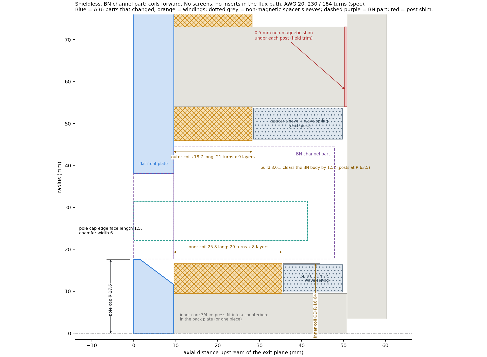
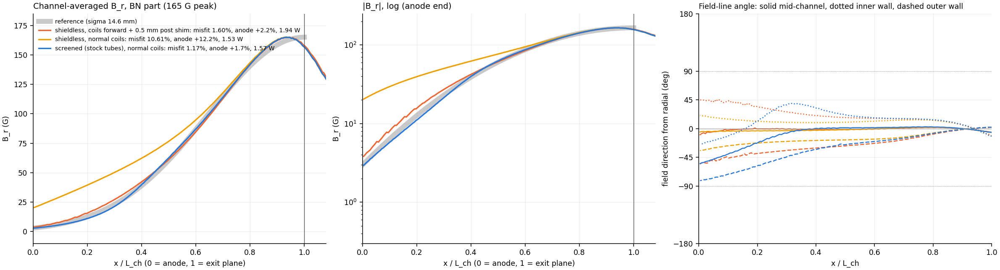
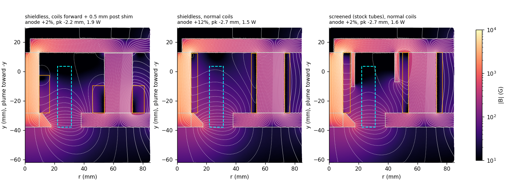

# Shieldless design on the boron nitride channel part (2-D axisymmetric, 2026-10-22)

**Brief** (user, 2026-10-21): rerun normal and forward coils on the new BN part, then keep sweeping
shieldless options until there is a solution worth committing to, with manufacturability in mind.

Code: `bn_noshield.py`, run with `AXISYM_CONFIG=bn`. Data: `results/bn_noshield/` (232 runs). Names
follow `figures/glossary.png`. The BN geometry and its assumptions are listed in `BN_REPORT.md`; the
**channel inner radius R 22.12 is still an assumption**.

## The design

**No screens and no inserts in the flux path.** The two main changes are winding both coil sets short
and deep against the front of the magnet, and a 0.5 mm shim under each outer post.

| part | spec |
|---|---|
| inner core | 3/4 in (the existing part). **Press-fit into a shallow counterbore in the back plate, or make the two one piece** (see robustness) |
| pole cap | R 17.6 (inside the Ø1.395 BN bore), 9.525 thick, edge face length 1.5, chamfer width 6 |
| front plate | flat, Ø3.0 bore (rests on the BN shoulder) |
| inner coil | 230 turns AWG 20, **29 turns x 8 layers**: 25.8 mm long, OD R 16.64. Seated against the pole cap. It sits inside the BN bore, which gives 1.08 mm of radial clearance and acts as its radial cage |
| outer coils (x4) | 184 turns AWG 20, **21 turns x 9 layers**: 18.7 mm long, 8.0 mm build. Seated against the front plate. 1.5 mm clear of the BN body (posts at R 63.5) |
| behind each coil | non-magnetic spacer sleeve (aluminium, or anything non-magnetic) plus a non-magnetic wave spring (BeCu, phosphor bronze or Inconel; **not 17-7PH**), clamping the coil forward |
| outer posts | **0.5 mm non-magnetic shim** under each post (field trim) |

The winding counts are real layer counts at a 0.89 mm wire pitch. The spec windings are exactly 46 x 5
and 46 x 4 at the same pitch. Power is computed for the fixed turns.

## Performance (2-D, 165 G peak)

| | reference | **this design** | shieldless, normal coils | screened, stock tubes (`BN_REPORT.md`) |
|---|---|---|---|---|
| misfit to reference | 0 | **1.60 %** | 10.6 % | 1.17 % |
| B_r at anode | 1.8 % | **2.2 %** | 12.2 % | 1.7 % |
| reversal anywhere in channel | | **none** (min B_r +1.8 %) | none | none (+0.6 %) |
| back-half axial-dominated area | | **0 %** | 0 % | 9 % |
| peak position | at exit plane | 2.2 mm inside | 2.7 mm inside | 2.7 mm inside |
| coil power | | **1.94 W** | 1.53 W | 1.57 W |
| inner / outer current | | 0.95 / 0.75 A | 0.91 / 0.72 A | 0.91 / 0.72 A |
| worst iron saturation ratio | | 0.23 | 0.25 | 0.29 |

**Field shape.** Mid-channel the field lines stay radial all the way to the anode. At the walls they
tilt to at most about 45° (inner wall) and 50° (outer wall), the unavoidable decay-driven B_z. The
screened design reaches about 80° at the outer wall near the anode. This design has the most radial
field of the three.

**Against the screened design:** misfit 1.60 % vs 1.17 %, and 24 % more power. The gain is two fewer
tubes to buy, fit and anneal, and a field shape that is if anything better.

## How it was reached

| step | runs | finding |
|---|---|---|
| normal coils | 5 | 10.6 % misfit, 12 % anode field: the shieldless baseline is poor |
| coils forward, as far as the 3/4 in core allows | | 1.75 % misfit, no reversal, 1.83 W: the idea carries over |
| core size 3/4, 11/16, 5/8, 1/2 in, every inner layer count that fits the bore, outer at 4/6/8/10 layers | 92 | a thinner core lets the coil sit further forward, but the best is only marginally better (11/16 in: 1.5 % vs 1.75 %) and the core flux density rises (1/2 in: 0.76 T). **Keep the 3/4 in core** |
| pole cap thickness 9.525 / 7.94 / 6.35 / 4.76 | 24 | thinner is always worse (misfit 2.2-4.8 %). Keep the full 9.525 cap |
| pole cap chamfer | 51 | plateau at 1.5-1.9 %; edge face length 1.5-2.5, chamfer width 4.5-6 |
| outer layering 8/9/10 x pole cap x post shim 0-2 mm | 36 | a 1-2 mm shim brings the anode field to 1.1-1.8 % with no reversal. **9 layers** gives 1.5 mm clearance to the BN body for almost no cost |
| robustness | 24 | below |

## Robustness (`results/bn_noshield/robust.csv`)

| case | misfit | B_r at anode | worst reversal | power |
|---|---|---|---|---|
| nominal | 1.60 % | 2.24 % | none | 1.94 W |
| all iron at mu_r 500 / 1000 / 5000 | 1.24 / 1.47 / 1.81 % | 1.1 / 2.0 / 2.6 % | none | 2.25 / 2.02 / 1.84 W |
| all iron at mu_r 200 | 2.02 % | −1.3 % | −2.9 % | 3.0 W |
| inner core joint gap 0.02 / 0.05 / 0.1 mm | 1.37 / 1.25 / 1.61 % | 1.7 / 0.8 / −0.4 % | none / −0.4 / −2.4 % | 2.0-2.2 W |
| post shim 0 / 0.75 / 1.5 mm | 1.94 / 1.48 / 1.28 % | 2.8 / 2.0 / 1.4 % | none | 1.86-2.06 W |
| inner coil 0.5 / 1 / 2 mm off the pole cap | 1.82 / 2.11 / 2.78 % | 2.4-2.9 % | none | 1.94 W |
| outer coils 0.5 / 1 / 2 mm off the front plate | 1.67-1.98 % | 2.3-2.5 % | none | 1.94 W |
| pole cap ±0.5 mm | 1.60-1.62 % | 2.2 % | none | 1.9 W |
| **worst low:** mu_r 500 + 0.05 mm joint gap | 1.50 % | −0.2 % | −1.8 % | 2.41 W |
| **worst high:** mu_r 5000, no shim | 2.18 % | 3.2 % | none | 1.76 W |

**What the build has to get right:**

1. **Inner core to back plate joint.** It is the one sensitive interface: a 0.1 mm gap reverses the
   field near the anode. Press-fitting the core into a counterbore (depth at least half the core radius,
   about 5 mm) roughly doubles the contact area through the side wall, and a press fit leaves no radial
   gap. The joint then stops mattering. Alternatively machine the core and back plate as one part. Do
   not paint or plate the faces.
2. **Iron permeability of at least about 500** at about 0.3 T. Annealed A36 or 1018 normally meets it.
   Hard cold-worked bar may not, which is the mu_r 200 case.
3. **Coil seating.** A spring keeps each coil against the pole cap or front plate. 1 mm of looseness
   costs 0.5 % misfit and nothing else.
4. **Post shim.** It is a trim and forgiving: about 0.6 % of peak per mm. Use 0.5 mm nominal. If the
   measured anode field comes out high, go to 1 mm; if low, remove it. Post-to-back-plate fasteners
   through the shim should be non-magnetic (316, brass or titanium) so they don't bridge it.

The tolerance band (worst reversal −1.8 %) matches the accepted screened design on the old part
(−1.6 %).

## Still open

- **Channel inner radius** (assumed R 22.12): rerun if it differs.
- **Thermal.** Both coils sit against the front of the magnet. The inner coil is inside the BN bore,
  about 4.4 mm of BN from the inner channel wall, close to the plasma. Check against the 240 °C wire
  rating.
- **3-D.** The four outer coils are discrete. A 3-D nonlinear solve should confirm the anode field and
  the absence of reversal.
- **Winding fit.** The square-wound counts fit exactly (232 / 189 turn positions). Real winding with
  lead-outs and layer crossovers needs about 1 mm of axial allowance on each coil. The 1.08 mm radial
  clearance in the bore covers insulation wrap.

Reproduce: `AXISYM_CONFIG=bn python bn_noshield.py refs grid capT chamfer finish robust figures` (the
chosen design is in `results/bn_noshield/best.json`).
