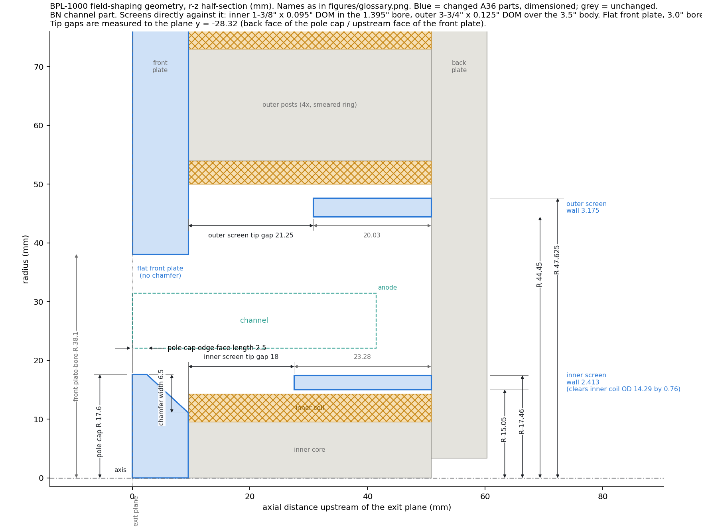
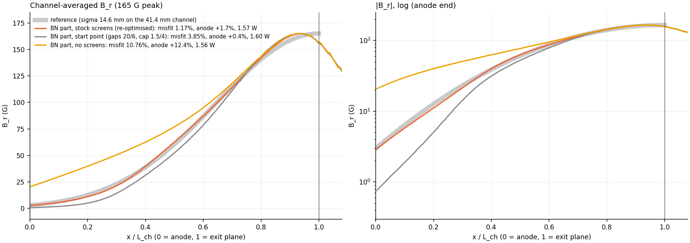
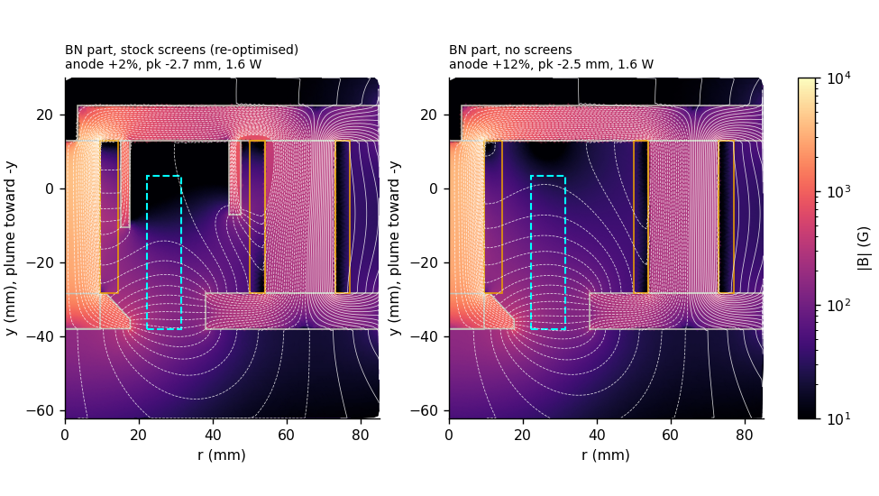

# Screened design on the boron nitride channel part (2-D axisymmetric, 2026-10-21)

Code: `bn_design.py`, run with `AXISYM_CONFIG=bn`. Data: `results/bn/`. Names follow
`figures/glossary.png`.

## Inputs

From drawing Boron_Nitride_Channel (inches) and the user's answers:

| item | value used |
|---|---|
| BN body | Ø3.5 x 1.506 behind a Ø3.0 x .375 lip |
| front plate | rests on the shoulder, so its bore is Ø3.0 (R 38.1); flat, no chamfer; lip flush with the exit plane |
| pole cap | R 17.6, inside the Ø1.395 bore with 0.12 mm clearance |
| channel outer radius | R 31.45 (from the .512 outer wall) |
| channel inner radius | **R 22.12: assumed, not dimensioned on the drawing** |
| channel length | 41.43 mm: the bottom 6.35 mm of the channel is filled, so the anode face is 6.35 mm above the part's back face |
| reference sigma | 0.353 L_ch = **14.6 mm** (was 11.66 on the old 33.02 mm channel); peak 165 G |
| outer posts | at R 63.5 (2.5 in), so the outer coils start at R 50.0 |
| post length, coils, back plate | unchanged |

**Screens, directly against the part:**
- **inner:** inside the bore, outer radius up to R 17.62;
- **outer:** over the body, inner radius R 44.45, outer radius up to R 49.5 (outer coils at 50.0).

The old configuration still runs unchanged; the base results reproduce exactly.

## Result

All four screen-wall options converge to the same fit:

| inner screen | outer screen | misfit | B_r at anode | power at 165 G |
|---|---|---|---|---|
| exact fit R 14.69-17.62 (2.93 wall) | 3-3/4 x .125 DOM, R 44.45-47.63 | 1.25 % | 1.9 % | 1.53 W |
| **1-3/8 x .095 DOM, R 15.05-17.46 (2.41 wall)** | **3-3/4 x .125 DOM** | **1.17 %** | **1.7 %** | **1.57 W** |
| exact fit | thick, R 44.45-49.5 | 1.12 % | 1.8 % | 1.57 W |
| 1-3/8 x .095 DOM | thick | 1.17 % | 1.8 % | 1.56 W |

**Recommended: both stock tubes.**

| feature | value (mm) |
|---|---|
| pole cap R | 17.6 |
| pole cap edge face length | 2.5 |
| pole cap chamfer width | 6.5 |
| inner screen tip gap | 18.0 (screen 23.28 long) |
| outer screen tip gap | 21.25 (screen 20.03 long) |

Performance:
- misfit 1.17 %;
- B_r at anode 1.7 %, against 1.8 % for the reference;
- no reversal: most negative pointwise B_r +0.6 %;
- back-half axial-dominated area 9 %, about the same as the earlier screened design;
- peak 2.7 mm inside the channel;
- 1.57 W at 165 G, 0.91 / 0.72 A (2-D).

**Against the previous screened design** (old channel, pole cap R 20.5,
1.07 % misfit, 0.61 W): the fit is as good, but **power is 2.6x higher**.
- The cause is the smaller pole cap (R 17.6 vs 20.5) and the wider front plate
  bore (R 38.1 vs 34.9): the pole faces are now 4.5 and 6.6 mm from the channel
  walls instead of 1.6 and 3.3.
- The pole cap radius was already known to be the strongest power lever.

**Without screens** on this part: misfit 10.8 %, anode 12.4 % (`figures/bn/profiles.png`).

## Robustness (`results/bn/robust.csv`)

- **±0.5 mm on either tip gap or the pole cap edge face / chamfer width:**
  misfit 1.17-1.30 %, anode 1.7-1.8 %.
- **Screens at mu_r 500 / 200 / 100 (rest of the iron at 5000):** anode
  2.4 / 3.4 / 4.7 %, misfit 1.19 / 1.70 / 2.77 %, no reversal.
  - The thin (2.41 mm) stock inner screen makes annealing slightly more worth
    doing than before.
- **All iron at mu_r 200-5000:** shape unchanged (misfit 1.17-1.30 %). Power is
  1.47-2.64 W.
- **Contact gap at the inner core / back plate joint:**
  - with screens, the anode B_r is insensitive (1.8-1.9 % at 0.05-0.1 mm);
  - but the back-half axial-dominated area rises from 9 % to 15-19 %;
  - so keep that joint faced and tight anyway.

## Open items

- **Confirm the channel inner radius,** which isn't dimensioned. If it differs
  from 22.12 the run needs repeating; it takes about 15 minutes.
- **3-D:** the outer screen sits right next to the four discrete outer coils.
  3-D will show how much the azimuthal variation matters.
- **Power:** 2.6x higher than the old channel. If that is a problem, the only
  large lever left is a pole cap radius beyond the BN bore, i.e. a BN part with
  a larger bore or a thinner inner wall.
