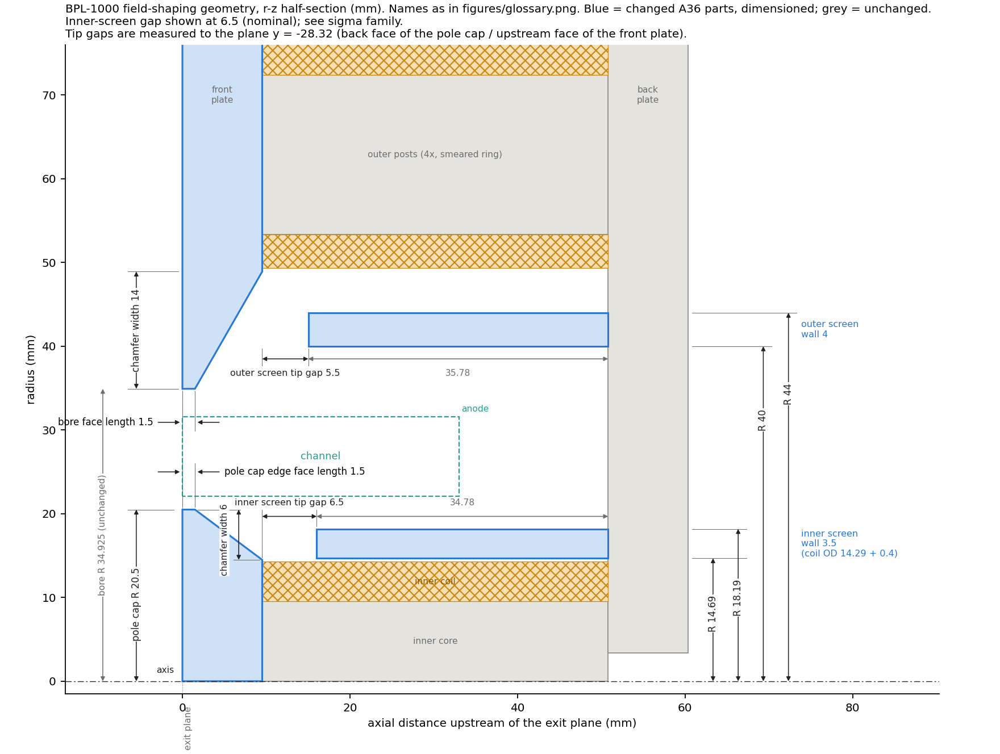
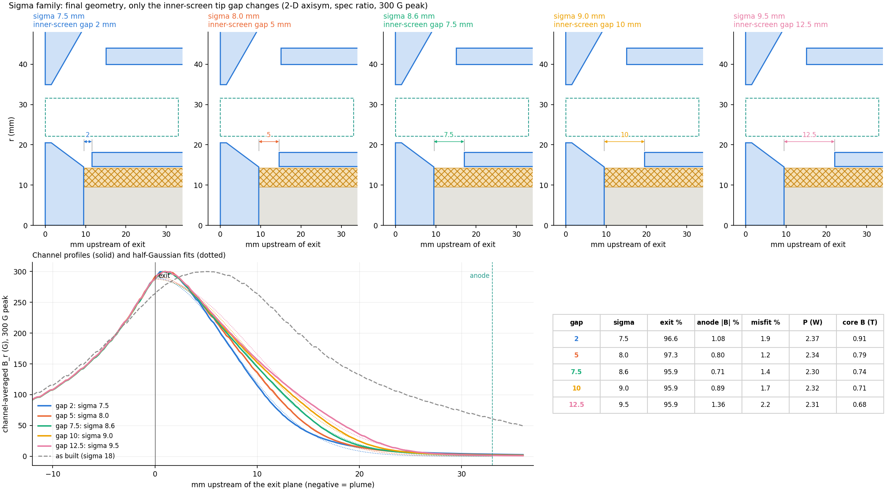
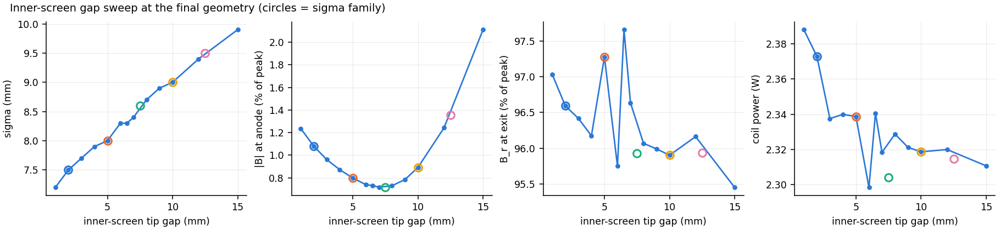

# How we arrived at the field-shaping geometry, BPL-1000 (2026-10-21)

This summary pulls together the 2-D field-shaping work from 2026-10-15 to
2026-10-21. Details live in `SHAPING_REPORT.md` (screening study) and
`OPTIMISE_REPORT.md` (optimisation). The final geometry and the sigma family
come from `final_design.py`.

**Goal.** The channel-averaged radial field B_r should look like a
half-Gaussian: largest at the exit plane and as small as possible at the
anode. The simplest parts that do the job are preferred.

**Constraints.**
- The channel shape is fixed.
- Plates, cores and screens are A36. The anode is 316L (non-magnetic).
- The pole pieces and anything around the channel are free to change.
- Iron parts must stay within the channel keep-out (r 20.62) and the
  outer-coil envelope (r 49).

## Result

| | as built | **final (gap 6.5)** |
|---|---|---|
| B_r at exit plane (% of peak) | 88 | **96-98** |
| peak position (mm, - = inside channel) | -5.0 | **-1.0** (flat top) |
| \|B\| at anode (% of peak) | 20 | **0.7** |
| half-Gaussian sigma (mm) | 18.4 | **8.3** (adjustable 7.2-9.9, see below) |
| misfit to a half-Gaussian (RMS % of peak) | 7.9 | **1.1** |
| coil power for 300 G peak (W) | 2.5 | **2.3** |
| worst iron saturation ratio | - | **0.51** (inner core) |

All values are 2-D axisymmetric, at the spec outer/inner ratio (0.635),
scaled to a 300 G peak. The as-built power is from the 10-18 study at its
minimum-power ratio.

Four parts change. All are A36:

1. **Front plate:** the bore rim is thinned to 1.5 mm. A back-side taper runs
   14 mm out radially from the bore.
2. **Inner pole cap:** the radius grows from 17.46 to 20.5 mm. The rim is
   1.5 mm thick, with a 6 mm back-side taper. The front face stays flush with
   the exit plane.
3. **Inner screen:** a tube, r 14.69-18.19 (3.5 mm wall), standing on the
   back plate. It sits just outside the inner coil, with 0.4 mm clearance. Its
   tip stops a set **gap** short of the cap back face. That gap sets sigma.
4. **Outer screen:** a tube, r 40-44 (4 mm wall), standing on the back plate.
   Its tip stops 5.5 mm short of the front plate.

The cores, coils, outer posts, back plate and channel are unchanged.

(`figures/final/dimensioned.svg` is the vector version. Gaps are measured to
the plane of the cap back face, which is also the front-plate inner face,
y = -28.32.)

## Choosing sigma: the inner-screen gap

Only the inner-screen tip gap changes across these arrangements. Everything
else stays at the final geometry.

| gap (mm) | sigma (mm) | exit B_r % | anode \|B\| % | misfit % | P (W) | inner-core flux B (T) |
|---|---|---|---|---|---|---|
| 2.0 | 7.5 | 96.6 | 1.08 | 1.9 | 2.37 | 0.91 |
| 5.0 | 8.0 | 97.3 | 0.80 | 1.2 | 2.34 | 0.79 |
| 7.5 | 8.6 | 95.9 | 0.71 | 1.4 | 2.30 | 0.74 |
| 10.0 | 9.0 | 95.9 | 0.89 | 1.7 | 2.32 | 0.71 |
| 12.5 | 9.5 | 95.9 | 1.36 | 2.2 | 2.31 | 0.68 |

How to read the table:
- **Sigma rises smoothly with the gap,** about 0.2 mm of sigma per 1 mm of
  gap, from 7.2 mm (gap 1) to 9.9 mm (gap 15). Data:
  `results/final/gap_sweep.csv`.
- **The anode field is lowest at gaps of 5-8 mm.** It doubles toward either
  end of the range.
- **The Gaussian fit is best at gaps of 5-7 mm.** The family pays for a
  tighter or wider sigma with a slightly worse fit (1.9-2.2 %).
- **Power is flat** at 2.30-2.37 W.
- **Small gaps load the inner core.** The core's flux-mean field reaches
  0.91 T at a 2 mm gap, against 0.74 T at 7.5 mm. Even at a 1 mm gap the
  saturation ratio is only 0.66.
- **The exit B_r column is noise.** It scatters between 95.5 and 97.7 % with
  no trend, because the profile top is flat and its position on the sample
  grid hops by 0.5-1 mm.

**Gaps of 5-7.5 mm (sigma 8.0-8.6 mm) are the sweet spot** if no plasma
requirement pushes sigma elsewhere. Outside that band the field shape is
still very good, but the anode field and the misfit roughly double.

## How we got here

### 1. Theory: what can move the field at all

The channel is air, so B in the channel is set entirely by the magnetic
potential of the surrounding iron and windings. Three separate things
control the profile:

1. **Peak position** follows the axial centre of the facing pole surfaces
   (the front-plate bore and the inner pole cap). With flat 9.5 mm plates the
   peak sits 5 mm inside the channel.
   - Lever: thin or taper the pole tips at the exit face.
2. **The anode field** comes from the ampere-turns behind each axial station.
   A loop from the core across the channel, back through the posts and the
   back plate, encloses only those turns. As built, 43 % of the turns sit
   behind the anode plane, so about 20 % of the peak field remains at the
   anode. Three levers:
   - move the turns forward
   - add a reluctance in the core return
   - hold both channel walls at back-plate potential with iron screens
3. **Sigma** depends on how far the pole-gap fringe field reaches into the
   channel. Between equipotential walls the fringe decays like
   exp(-pi d / D).
   - Lever: screens, through how close their tips come to the poles.

Two things **cannot** change the shape:
- **The inner/outer A-turn ratio.** The circuit is in series and both coils
  have the same axial layout.
- **Back-plate thickness,** unless the plate saturates.

The simulations confirmed both.

### 2. Model

The model is a 2-D axisymmetric gmsh/GetDP solve of the full circuit:
- the square plates become discs of equal area
- the 4 outer posts become a smeared ring with the same axial reluctance

It takes about 15 s per geometry. Calibrated against the 3-D final-spec
solve, the shape agrees within 1 % RMS and the amplitude is 5-7 % high
(`calibrate.py`).

### 3. Screening study (2026-10-15 to 10-18): which features earn their place

| lever | what it did | verdict |
|---|---|---|
| Tapered front plate + tapered, larger pole cap | peak -5.0 to -1.2 mm; anode barely moved (20 to 17 %) | **kept**, fixes peak position |
| Thinner plates overall (flat) | moves the peak, nothing else; tapers do it better | dropped |
| **Inner screen** | anode 17 to 3.6 %, sigma 14 to 9 mm, no power cost | **kept**, best value per part |
| **Outer screen** (with the inner one) | anode to 0.6 %, misfit to 1.7 %; alone it does nothing | **kept** |
| Inner coil moved forward | anode to about 3 %; redundant once a screen hides the coil | dropped |
| Air gap behind the inner core | nulls the anode field, but 2.6-3.7x the power | dropped |
| Post gaps, back-plate thickness | no effect on shape | dropped |
| 2 mm cap lip into the plume | puts the peak exactly on the exit (-0.2 mm) | dropped by user (plume erosion, extra part) |
| Trim coil | works in principle | deferred by user |

### 4. Optimisation (2026-10-20)

We optimised the kept features with no lip and with sigma left unscored:
- one-at-a-time sweeps of the tapers and screens
- a compass search over 9 variables
- a ±0.5 mm tolerance check

Each run also recorded the iron saturation ratio per part.

Findings:
- **Pole-cap radius is the strongest lever,** for power. 17.5 to 20.6 mm cuts
  power from 4.9 to 2.2 W. **20.5 mm** is the largest radius that leaves
  margin to the keep-out (20.62).
- **Thin rims (1.5 mm) give the cleanest Gaussian.** A flat cap rim gives a
  7.7 % misfit.
- **Taper widths of 6 mm (cap) and 10-15 mm (front plate)** are on a plateau.
- **The inner-screen gap is the sigma knob.** The screen wall needs 3 mm or
  more. A tip flare gives no benefit.
- **The outer-screen gap can be up to about 6 mm.** The wall thickness barely
  matters.
- **No part saturates** anywhere in the explored space (worst ratio 0.68).
- **Without the lip, the peak stays 0.5-1.5 mm inside the channel.** B_r at
  the exit is 95-98 % of the peak, on a flat top.

### 5. Final choices (2026-10-21)

- **Outer-screen wall: 4 mm, not the optimiser's 7 mm.** The 7 mm was drift:
  ±0.5 mm changes nothing, and 3 to 5 mm is worth 0.1 objective points.
  The 4 mm design matches the 7 mm one within noise: at a 6.5 mm gap, anode
  0.73 vs 0.7 %, sigma 8.3 vs 8.3 mm, misfit 1.13 vs 1.1 %, power 2.34 vs
  2.36 W.
- **Inner-screen gap: left as a family** (above) until we pick sigma. The
  drawing shows 6.5 mm.

## Caveats and open items

- **The peak does not land exactly on the exit plane.** It sits about 1 mm
  inside, with the exit at 96-98 % of peak. Only the cap lip fixes this, and
  it was declined.
- **These are 2-D linear-iron results.** The 2-D currents are not the 3-D
  spec values. Saturation has about 2x margin in the inner core, but the 3-D
  nonlinear solve should confirm it.
- **The real plates are square,** and flux crowds near the posts. 2-D plate
  loads are low (≤ 0.1), so there is margin.
- **CAD fit is not checked yet.** Three things to verify:
  - the cap at r 20.5 against the 20.62 keep-out
  - the inner screen's 0.4 mm clearance over the coil OD, which assumes the
    winding build is as specified
  - the outer screen against the chamber, gas feed and anode wiring
- **Next steps:** pick sigma, run the 3-D nonlinear confirmation, then the
  Onshape fit check.

Reproduce: `python final_design.py figures` (gap sweep, family, as-built
reference, drawing). Solves are cached in `runs/opt/`.

## Update 2026-10-21: matching the supplied reference profile

The target was then set to a reference curve: a half-Gaussian with
sigma = 0.353 L_ch = 11.7 mm, 165 G peak. That is wider than this sigma
family can reach. Two changes match it to 3 % RMS: **a flat pole cap and a
21 mm inner-screen gap**. See `TARGET_REPORT.md`.
