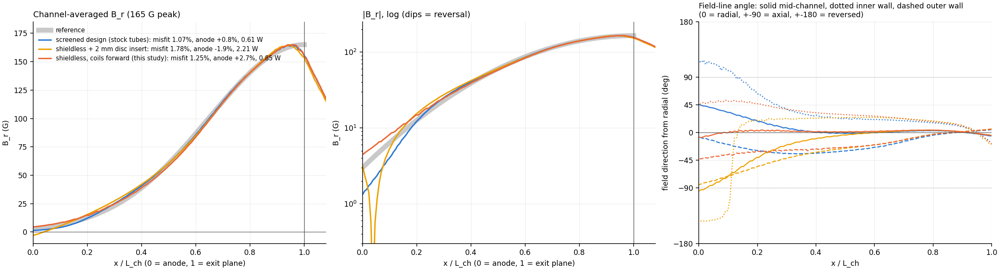
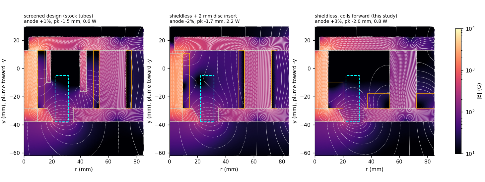
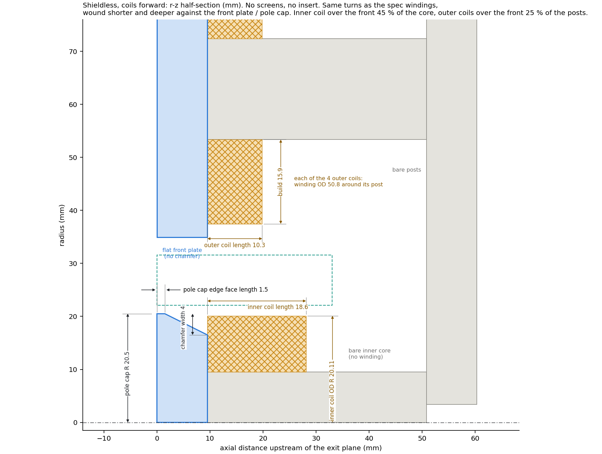

# Shieldless configurations scored on field shape (2-D axisymmetric, 2026-10-21)

**Brief** (user): the 2 mm disc insert bends the field lines axial near the
anode. Explore shieldless configurations (inserts and anything else) and
judge each on field shape as well as on the reference profile.

**Fixed:** no screens, flat front plate, pole cap radius 20.5, nothing past
the exit plane. Names follow `figures/glossary.png`. Code: `noshield.py`.
Data: `results/noshield/` (about 190 runs).

## Answer

**Move the coils, not the iron.** Same turns and same wire, wound shorter and
deeper, up against the front plate and the pole cap:

- **inner coil:** over the front 45 % of the inner core, 18.6 mm long, OD R 20.11;
- **outer coils:** over the front 25 % of the posts, 10.3 mm long with a
  15.9 mm build, which is a winding OD of 50.8 around each post;
- **pole cap:** edge face length 1.5, chamfer width 4.

There is no insert and no screen. The rear of the inner core and of the posts
is bare iron.

| | screened design (stock tubes) | shieldless + 2 mm disc insert | **shieldless, coils forward** |
|---|---|---|---|
| misfit to reference | 1.07 % | 1.78 % | **1.25 %** |
| B_r at anode (reference 1.8 %) | +0.8 % | −1.9 % | +2.7 % |
| most negative pointwise B_r in channel | −1.6 % | −8.1 % | **+1.9 % (no reversal)** |
| smallest pointwise \|B\| in channel | 1.3 % | 0.8 % (null) | **2.7 % (no null)** |
| back half: % of points axial-dominated with \|B_z\| > 5 % | 10 % | 33 % | **2.3 %** |
| back half: 95th-percentile \|B_z\| | 15.2 % | 15.4 % | 13.7 % |
| peak position, sigma | −1.5 mm, 12.2 mm | −1.7 mm, 12.3 mm | −2.0 mm, 12.1 mm |
| coil power at 165 G | 0.61 W | 2.21 W | 0.85 W |
| inner / outer current at 165 G | 0.57 / 0.45 A | 1.07 / 0.85 A | 0.56 / 0.45 A |
| worst saturation ratio at 165 G | 0.22 | 0.17 | 0.19 |

**Field shape** (right panel of the profile figure):
- **Coils forward:** mid-channel field lines stay radial (about 0°) right up to
  the anode. At the walls they tilt to at most about 45-50°.
- **Screened design:** tilts to about 45° mid-channel near the anode and past
  axial (about 110°) at the inner wall.
- **2 mm disc insert:** fully axial mid-channel and reversed at the inner wall.

So the coils-forward design has the most radial field near the anode of the
three, with a fit close to the screened design and about 40 % more power.

## Why: B_z itself is not the problem

**Some axial field is unavoidable.** In the current-free channel, curl B = 0
gives dB_z/dr = dB_r/dz. A B_r that decays toward the anode like the
reference therefore forces B_z to change across the channel width: about
±20 % of peak at the walls in the back half for the reference itself. All
three designs have a similar |B_z| (95th percentile 14-15 %).

**What turns the field lines axial is B_r going through zero.** Where B_r
reverses, the leftover B_z dominates and a null forms. That happens with the
insert, because the gap shifts the core potential past the point where the
anode field is cancelled. Moving the coil does not. It removes the turns
behind the anode plane (the source of the anode tail), so B_r falls toward
zero from above without crossing it.

## What was tried

| family | best result | verdict |
|---|---|---|
| inner / outer coil placement, front fraction of core / posts (24 runs) | f_in 0.45, f_out 0.25: misfit 1.64 %, no reversal, 0.81 W | **winner**. The inner coil matters most; f_in is limited to ≥ 0.446 because its build would cross the channel keep-out (R 20.2) |
| pole cap chamfer and fine coil grid at the winner (78 runs) | edge face length 1.5, chamfer width 4: 1.25 % | small gain |
| non-magnetic insert cutting the inner core part-way (split, 27 runs) | the rear is best; every split location is worse than the rear disc and costs power | dropped |
| rear disc insert 0.5-1.5 mm (5 runs) | thin enough to avoid reversal (≤ 1 mm) leaves 4-8 % anode field and 1.1-1.6 W | dropped |
| coils forward + very thin insert, 0.1-0.75 mm (80 runs) | best 1.45 %, but it brings back a reversal and a near-null, and 0.1 mm already shifts the anode by about 2.5 % of peak | dropped |

## Robustness of the coils-forward design (`results/noshield/robust.csv`)

- **Permeability, all iron at mu_r 500 / 3000 / 5000:** misfit 1.28 / 1.33 /
  1.38 %, anode 1.3 / 3.1 / 3.2 %, no reversal.
- **Permeability, all iron at mu_r 200:** B_r reverses (−3.7 %) and a null
  forms. The bare rear of the inner core then acts like an insert. The inner
  core should be well-annealed low-carbon steel.
- **Contact gap at the inner core / back plate joint:** 0.02 mm is harmless
  (anode 2.1 %). 0.05 mm gives a slight reversal (−0.3 %); 0.1 mm gives
  −1.9 %. **The joint must be a tight, faced contact,** bolted and with no
  paint or plating on the faces. This also applies to any design. It is
  sharpest here because the bare rear core carries the flux that sets the
  anode field.
- **Pole cap ±0.5 mm:** misfit 1.2-1.6 %.

## Practical checks still needed (not modelled)

- **Turns fit** (estimated with AWG 20, about 0.86 mm over insulation):
  - inner coil: 230 turns in 18.6 x 10.6 mm, about 21 turns/layer x 12
    layers = 252, fits;
  - outer coils: 184 turns in 10.3 x 15.9 mm, about 11 x 18 = 198, tight.
- **Inner coil OD (R 20.11):** 0.5 mm inside the channel keep-out (R 20.62).
  Check against the CAD.
- **Outer coils (OD 50.8 around each post):** they reach to about R 37.5 from
  the thruster axis, 4.4 mm outside the channel outer keep-out. They need to
  clear the chamber, gas feed and anode wiring. Square-plate check: post
  centre at 44.45 mm from the axis in x and y, plus the 25.4 mm coil radius,
  gives 69.9 < 76.2 mm half-width.
- **Thermal:** both coils now sit against the front plate and pole cap, closer
  to the plasma. The polyimide wire is rated 240 °C.
- **3-D:** in the real magnet the four outer coils are discrete, which 2-D
  can't capture. A 3-D nonlinear solve should confirm the anode field and the
  absence of reversal.

Reproduce: `python noshield.py refs coils coils2 inserts combos chamfers fine
robust figures` (after writing `results/noshield/best.json`).
