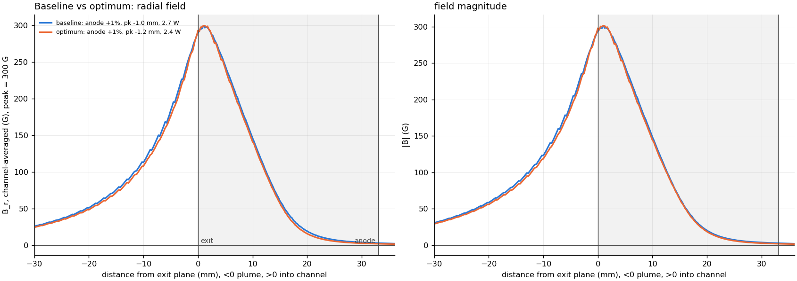
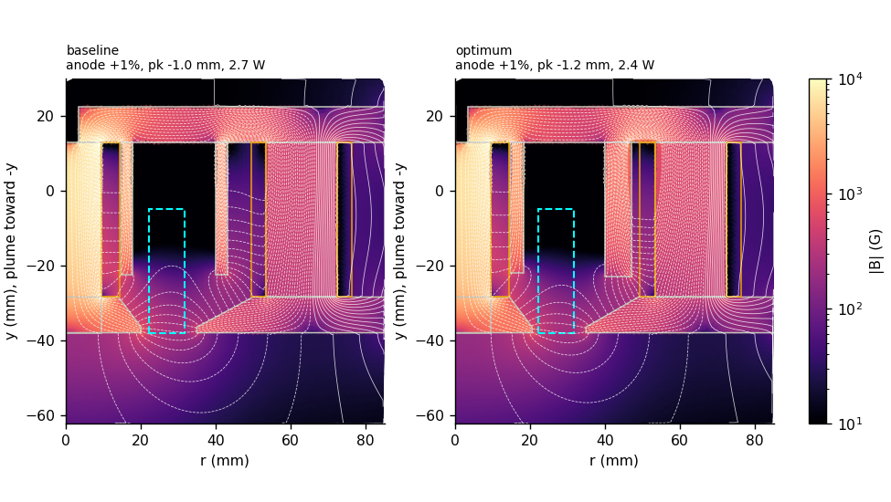
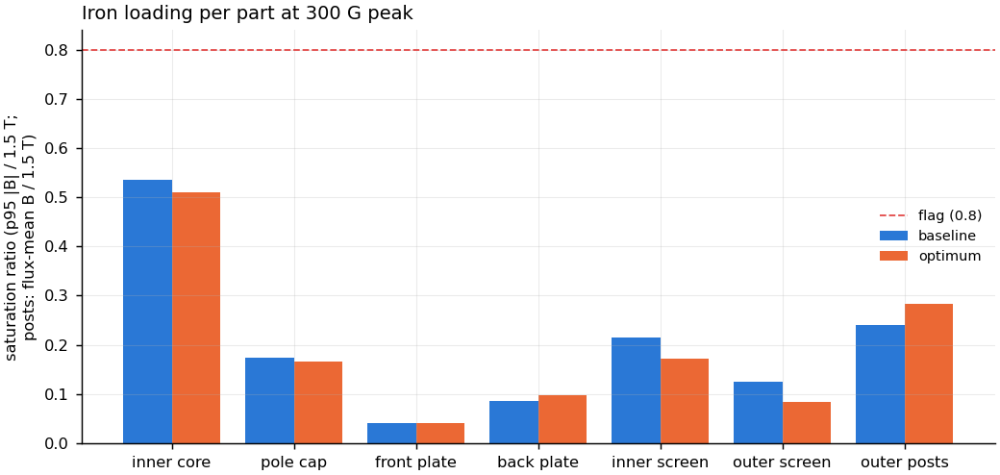
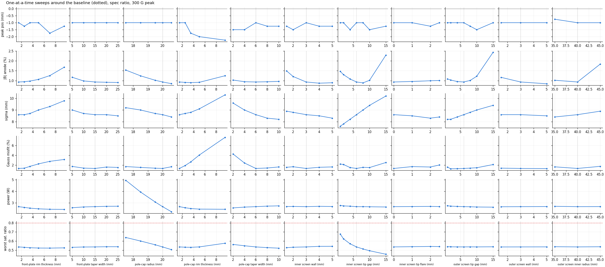

# Field-shaping optimisation, BPL-1000 (2-D axisymmetric, 2026-10-20)

**Features kept** (user, 2026-10-20): front-plate taper, pole-cap taper, inner
screen, outer screen. **No cap lip.** Sigma is recorded but not targeted.

**Setup.** Every run is at the spec outer/inner ratio (q = 0.635) with the
channel-averaged peak B_r scaled to 300 G. A36 iron, linear (mu_r 1500).
Saturation ratio = 95th-percentile |B| in the part / 1.5 T (the B-H proxy knee
used by the 3-D pipeline). For the inner core it is the larger of that and the
flux-mean B along the shaft. For the outer posts it is the ring flux divided
by the real area of the 4 posts, undoing the 2-D smear. Flag at 0.8.

Code: `optimise.py`. Data: `results/optimise/` (`sweeps.csv`,
`search_trace*.csv`, `tolerance.csv`, `optimum.json`). Every CSV row has ~70
columns: shape, plume leakage, wall profiles, coil drive, and mean / p95 / max
|B| plus saturation ratio for each of the 7 iron parts.

## Result

| | baseline (10-18 winner minus lip) | **optimum** |
|---|---|---|
| B_r at exit plane (% of peak) | 96.5 | **97.8** |
| peak position (mm, - = inside) | -1.0 | -1.2 (flat top, see below) |
| \|B\| at anode (% of peak) | 0.9 | **0.7** |
| sigma (mm) | 8.6 | 8.3 |
| half-Gaussian misfit (RMS %) | 1.3 | **1.1** |
| coil power (W) | 2.67 | **2.36 (-12 %)** |
| \|B\| 10 mm into the plume (% of peak) | 41 | 40 |
| worst saturation ratio (part) | 0.54 (inner core) | **0.51 (inner core)** |
| inner core flux-mean B (T) | 0.80 | 0.77 |
| outer posts flux-mean B (T) | 0.36 | 0.43 |

Optimum dimensions (mm):

| front plate | pole cap | inner screen | outer screen |
|---|---|---|---|
| rim 1.5, taper width 14 | r 20.5, rim 1.5, taper width 6 | r 14.69-18.19 (wall 3.5), tip gap 6.5, no flare | r 40-47 (wall 7), tip gap 5.5 |

**The two profiles are nearly identical.** The 10-18 design was already
close to optimal. The one gain that holds up is **12 % less power from the
0.5 mm larger pole cap**. The other gains are small.

## What each knob does (one-at-a-time sweeps)

| knob | effect | verdict |
|---|---|---|
| **pole-cap radius** | strongest lever: 17.5 -> 20.6 mm cuts power 4.9 -> 2.2 W and core flux 0.96 -> 0.76 T | as large as the keep-out allows. 20.5 is 0.12 mm under the 20.62 keep-out, so check the CAD |
| pole-cap / front-plate rim thickness | thinner = cleaner Gaussian. A flat 9.5 mm cap rim gives 7.7 % misfit | 1.5 mm (the floor) on both |
| pole-cap taper width | below 4 mm the shape degrades | 6-8 mm |
| front-plate taper width | weak; 5 mm is slightly worse | 10-15 mm |
| **inner screen tip gap** | **this is the sigma knob**: gap 1 -> 15 mm gives sigma 7.6 -> 10.2 mm. The anode floor is lowest at 6-8 mm. A small gap loads the core (1.0 T flux-mean at a 1 mm gap) | 5-7 mm. Pick it here when we settle on a sigma |
| inner screen wall | 3 mm or more; thinner raises the anode floor | 3-3.5 mm |
| inner screen flare | no benefit | drop it |
| outer screen tip gap | up to ~6 mm is fine; past 8 mm the anode floor rises | 4-6 mm |
| outer screen wall / radius | weak; r 45 is worse | wall 3-5 mm, r 40 |

**Saturation is not a constraint anywhere in the explored space.** The worst
part is always the inner core: ratio 0.45-0.68, peaking at an inner-screen
gap of 1 mm. The screens, plates and cap sit at 0.04-0.22.

## Findings to be aware of

1. **Without the lip, the peak cannot reach the exit plane.** Over all 470
   runs it sits 0.5-1.5 mm inside, with B_r at the exit 95-98 % of peak. The
   top is flat, and its argmax hops by 0.5-1 mm on sub-mm geometry changes. So
   the optimiser scores B_r *at the exit* rather than the peak position.
2. **The exit-field gain is not robust.** ±0.5 mm on the inner screen (wall,
   gap, flare) or the outer-screen gap drops it from 97.8 back to 95.7-96.9 %,
   which is the size of the gain itself. Anode floor, sigma, misfit, power and
   saturation stay within ±0.1 % / ±0.2 mm / ±0.4 W over the same tolerance
   band.
3. **The outer screen's 7 mm wall is optimiser drift.** ±0.5 mm changes
   nothing, and 3 -> 5 mm was worth 0.1 objective points at the baseline.
   **Recommend 3-5 mm** for weight and fit.
4. The field-line angle at the walls near the anode varies 30-90 deg with sub-mm
   changes. The field there is <1 % of peak, so the angle is ill-conditioned
   and says nothing about magnetic shielding in this topology. It is recorded
   only.

## Method

- Mesh noise: 0.01 mm nudges change the objective by ≤0.04, far below the
  sweep trends.
- Objective (lower = better): (100 - exit B_r %) + anode |B| % + Gaussian misfit
  % + 5 x (P / P_baseline - 1) + 100 x max(0, saturation ratio - 0.8).
- Compass search on a 2 / 1 / 0.5 mm grid, run twice: from the baseline
  (objective 4.40, `search_trace_from_base.csv`) and restarted from an earlier
  run's low-power point (**3.41**, `search_trace.csv`). That earlier run used
  the peak-position term and was discarded because of finding 1.

## Caveats

- 2-D axisymmetric, linear iron. Calibrated to 3-D within 1 % in shape. The
  2-D A-turns and currents (1.12 A inner / 0.89 A outer for 300 G here) are not
  the 3-D spec values. Iron loads scale with current, and the inner core has
  about 2x headroom at the optimum.
- The plates are discs here, but in the real square plates flux crowds near
  the 4 posts. Plate loads near the posts are understated (they sit at
  0.04-0.10 here, so there is margin).
- Next: 3-D nonlinear confirmation and the CAD fit check, especially the pole
  cap at r 20.5 and the inner screen r 14.69-18.19 between the coil OD (14.29)
  and the channel keep-out.

Reproduce: `python optimise.py baseline sweeps`, then
`python optimise.py search cap_r,cap_t,cap_w,fp_t,fp_w,is_t,is_gap,os_gap,os_t`,
then `python optimise.py tolerance figures`.
