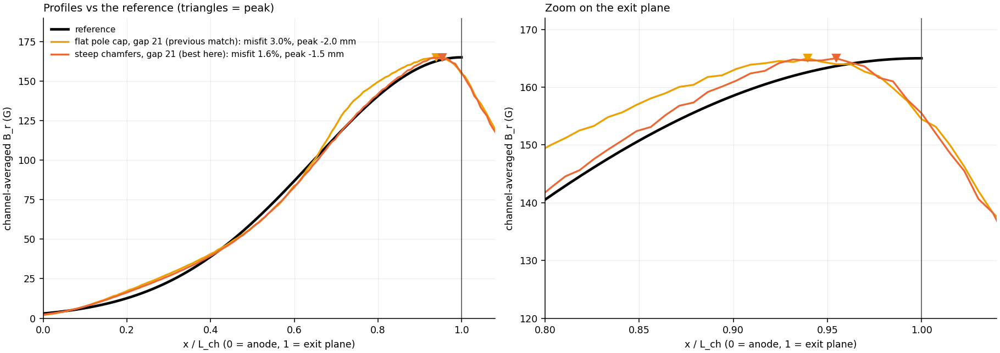
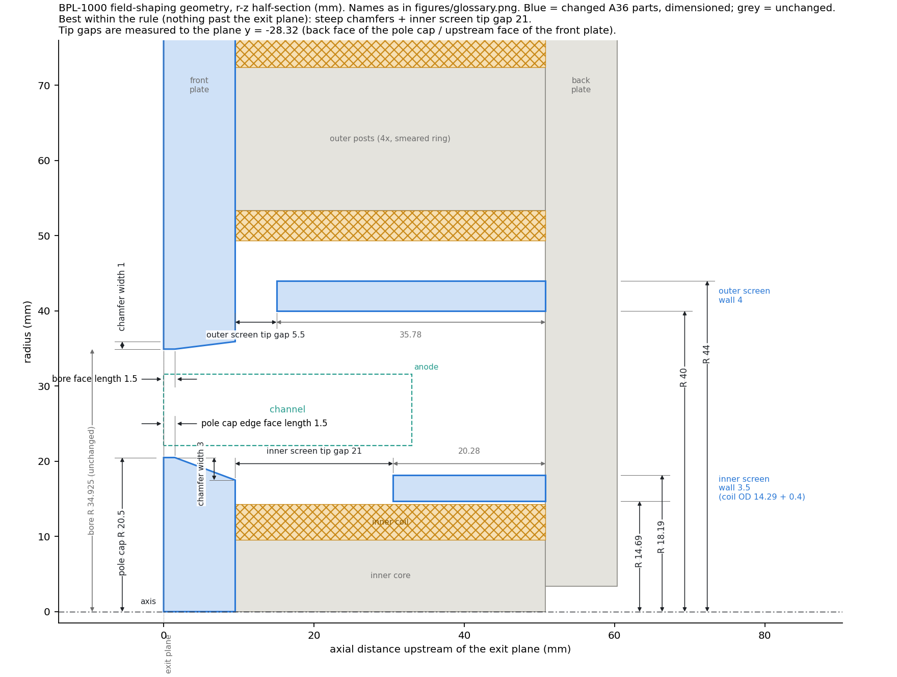
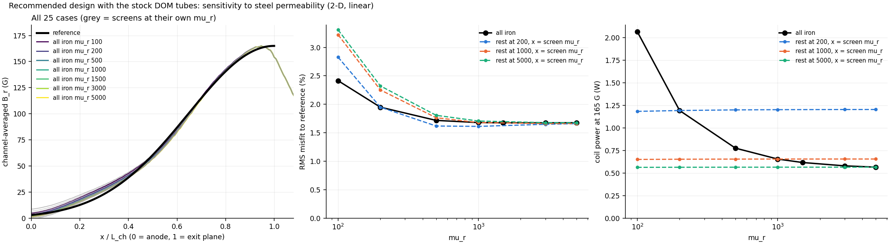

# Moving the B_r peak toward the exit plane (2-D axisymmetric, 2026-10-21)

**Question.** Can the B_r peak be moved onto the exit plane while keeping
the wide reference profile (sigma 11.66 mm, 165 G; `TARGET_REPORT.md`)?

**Rule** (user): nothing past the exit plane. The flush pole cap is allowed.

Feature names follow `figures/glossary.png`:
- **edge face length:** the axial length of the pole cap edge face (`cap_t`)
  or of the front plate bore face (`fp_t`)
- **chamfer width:** the radial width of the pole cap chamfer (`cap_w`) or
  of the front plate chamfer (`fp_w`)

## Answer

**No method gets the peak onto the exit plane under this rule.** Across
about 1,500 runs (this study plus `optimise.py`, `final_design.py` and
`target_sigma.py`), the closest the peak came is:
- **0.5 mm inside** the channel, with the narrow sigma-8 profile and 1.5 mm
  edge faces;
- **1.5 mm inside**, with a profile as wide as the reference.

**Why:** all the iron ends at the exit plane. The field leaving the two edge
faces spreads both upstream into the channel and downstream into the plume,
so B_r is already falling by the time it reaches the exit plane. The peak
therefore sits a little upstream of the downstream end of the edge faces:
- Shorter edge faces put it closer.
- A wider profile needs flux spread further up the channel, which pulls it
  back in.

The only way to put the peak on the exit plane is iron downstream of it.
The 2 mm extension of the pole cap tested on 10-18 reached 0.2 mm inside,
but it breaks the rule.

**How much it matters:** the reference itself is 99.2 % of its peak 1.5 mm
inside the exit plane, so the peak location alone costs almost nothing. The
real difference is at the exit plane: B_r there is 94 % of peak in our
design, against 100 % in the reference. That is the largest remaining
residual (−6 %).

## What each method did

Every method starts from the flat pole cap with a 21 mm inner screen tip
gap. That design matches the reference to 3.0 % misfit, with the peak
2.0 mm inside.

| method | best case | misfit to reference | peak (mm) | B_r at exit plane | coil power at 165 G |
|---|---|---|---|---|---|
| starting design | flat pole cap, inner screen tip gap 21 | 2.98 % | −2.0 | 93.6 % | 0.66 W |
| **1. steep chamfers** | pole cap: edge face length 1.5, chamfer width 3; front plate: edge face length 1.5, chamfer width 1 | **1.64 %** | **−1.5** | 94.2 % | **0.62 W** |
| 2. trim coil, upstream of the front plate bore face (r 33.1-39.5, 15 mm long) | trim at +1.16 x the inner coil's A-turns | 2.56 % | −2.0 | 94.1 % | 0.86 W |
| 2. trim coil, upstream of the pole cap (r 14.7-20.2) | trim at −0.12 to −0.20 x the inner coil's A-turns | 2.89 % | −2.0 | 93.8 % | 0.8-0.9 W |
| 3. smaller front plate bore radius | 34.2 (from 34.925) | 2.59 % | −1.7 | 94.1 % | 0.60 W |

Data: `results/peak/chamfers.csv` (768 runs), `trim.csv` and `bore.csv`.

1. **Steep chamfers** are the only method that improves the fit much, and
   they also lower power slightly.
   - Both edge faces are 1.5 mm long at the exit plane, but the chamfers
     behind them are narrow (3 mm and 1 mm radially, against 6 mm and 14 mm
     before). The iron behind each edge face therefore stays close to the
     channel for the full plate thickness.
   - This keeps the wide profile of a long edge face while shifting its
     weight toward the exit plane: the peak moves forward 0.5 mm and the
     misfit roughly halves.
   - Within this grid the peak never got closer than 1.0 mm. The four
     cases at 1.0 mm all have a 6 mm pole cap chamfer and fit the reference
     worse (3.7-9.4 % misfit).
2. **Trim coil:** small gains for 30-40 % more power. It only reshapes the
   field inside the iron envelope, so it doesn't move the peak.
3. **Smaller bore radius:** a 0.3 mm peak shift and a small misfit gain.
   34.2 and 33.5 are equally good; 33.1 is worse.

## Best design within the rule

The only change from the flat-pole-cap design is the two chamfers:
- **Pole cap:** edge face length 1.5 mm, chamfer width 3 mm.
- **Front plate:** edge face length 1.5 mm, chamfer width 1 mm.
- **Unchanged:** inner screen tip gap 21, inner screen wall 3.5, outer screen
  r 40-44 with tip gap 5.5, pole cap R 20.5.

Performance:
- **Fit:** 1.64 % RMS misfit (5.8 % max).
- **Peak:** 1.5 mm inside the channel; sigma 12.1 mm; half-depth 14.0 mm.
- **Field at the exit plane:** B_r 94.2 % of peak.
- **Field at the anode:** B_r 1.4 % of peak (|B| 4.5 %, mostly axial field
  off the inner screen tip).
- **Drive at 165 G:** 0.62 W, 0.57 A inner / 0.45 A outer, worst saturation
  ratio 0.23. These are 2-D values; the 2-D currents are not the 3-D spec
  values.

A 1 mm chamfer width on the front plate is a shallow 1.5 mm x 1 mm bevel.
In practice that is close to a flat bore with a chamfered edge, so check
whether it's worth machining at all: a flat front plate scored 1.73 %.

## Not done

- A compass search from the best chamfer case (`python peak_forward.py
  search`). It would mostly refine the fit, not the peak position.
- 3-D nonlinear confirmation and the CAD fit check, as for the earlier
  designs.

Reproduce: `python peak_forward.py chamfers trim bore figures`.

## Stock tubes and steel permeability (`permeability.py`)

The recommended design was re-run with two stock tubes in place of the
modelled screens. Both are Speedy Metals C1020 DOM, ASTM A513 Type 5,
delivered cold drawn:
- **inner screen:** 1-1/2" OD x 0.120" wall, r 16.00-19.05;
- **outer screen:** 3-1/2" OD x 0.188" wall, r 39.67-44.45.

At mu_r 1500 the stock sizes change almost nothing: misfit 1.67 % (1.64 %
with the modelled screens), peak 1.7 mm inside the channel.

**Permeability sweep** (21 solves; mu_r 100-5000 covers low-carbon steel
from cold-worked at very low field to fully annealed):

| case | misfit to reference | B_r at anode | coil power at 165 G |
|---|---|---|---|
| all iron, mu_r 500-5000 | 1.67-1.72 % | 0.7-1.3 % | 0.56-0.77 W |
| all iron, mu_r 200 / 100 | 1.95 / 2.41 % | 2.1 / 2.9 % | 1.19 / 2.06 W |
| screens mu_r ≥ 500, rest any value | 1.6-1.8 % | −0.4 to 1.8 % | set by the rest |
| **screens mu_r 200, rest 1000-5000** | 2.25-2.32 % | **3.1-3.3 %** | 0.56-0.65 W |
| **screens mu_r 100, rest 1000-5000** | 3.22-3.31 % | **5.1-5.3 %** | 0.56-0.65 W |

- **High permeability is never a problem.** Every result converges above
  mu_r about 1000.
- **Peak position is unaffected:** 1.7 mm inside the channel and B_r at the
  exit plane 93.5 % in every case.
- **Low permeability everywhere** mainly costs power, up to 3.3x at mu_r 100.
  The shape stays close (2.4 % misfit).
- **The one bad case is screens with much lower permeability than the rest
  of the iron.** A screen works by holding the channel walls at back-plate
  potential. A low-mu_r screen drops potential along its length and lets the
  coil drive leak back into the channel: the anode field rises 3-6x.
- **That is the likely real situation.** The screens run at only 0.05-0.09 T,
  where steel sits near its low initial permeability, and the DOM is cold
  drawn. The cores and plates run at higher fields where mu_r is higher.
  (This model is linear; the real B-H curve makes the low-field effect worse,
  not better.)
- **Fix:** anneal the two screens (low-carbon steel magnetic anneal, about
  840 °C in vacuum or inert gas, slow cool) to bring mu_r well above 500. A
  quick inductance test of a wound sample tube, before and after, confirms it.
