# Channel B-field shaping, BPL-1000 (2-D axisymmetric study, 2026-10-18)

**Goal.** Channel-averaged radial field B_r shaped as a half-Gaussian: peak on
the exit plane, as little field as possible at the anode. Plates and cores
A36 (iron), anode 316L (non-magnetic). Simplest solution preferred.

**Result.** Two magnetic screens (iron tubes on the back plate, one between
the inner coil and the channel, one between the channel and the outer coils)
plus a 2 mm lip on the inner pole cap give:

| | as built | pole tips (10-15) | **screens + lip** |
|---|---|---|---|
| peak position (mm, - = inside channel) | -5.0 | -1.2 | **-0.2** |
| B_r at anode (% of peak) | +20 | +17 | **+0.6** |
| \|B\| at anode (% of peak) | 23 | 20 | **2.0** |
| half-Gaussian sigma (mm) | 18.4 | 13.9 | **8.1** |
| misfit to a half-Gaussian (RMS, % of peak) | 7.8 | 8.2 | **1.1** |
| coil power for 300 G peak (W, min-power ratio) | 2.5 | 1.9 | **1.8** |

No power penalty, no extra coil. The **inner screen alone** delivers most of
it (anode +3.6 %, sigma 9.0 mm); the outer screen is only worth adding next
to the inner one.

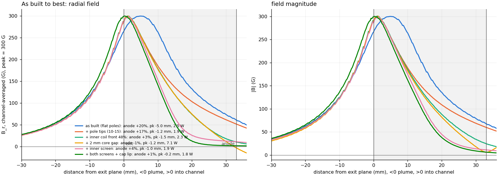
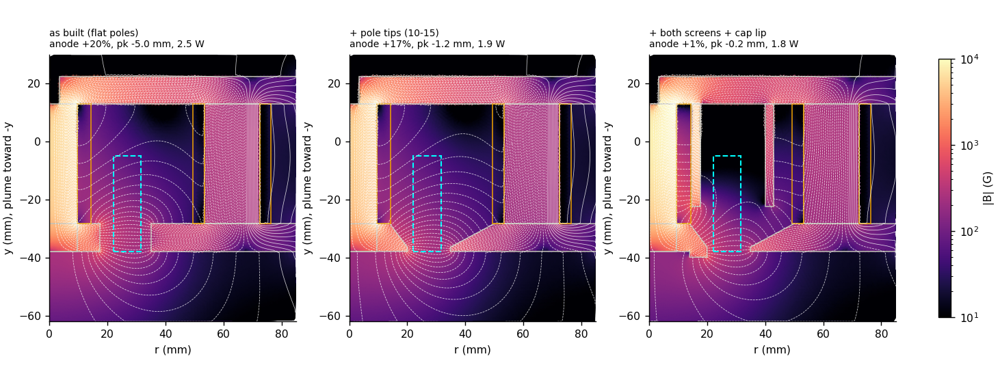

Field maps: colour is |B| (log), white lines are field lines (contours of
r A_phi), iron outlined grey, windings orange, channel dashed cyan.

---

## 1. Theory: what can move the field

The channel is air, so B there solves Laplace's equation. Its shape is fixed
entirely by the magnetic potential on the surrounding iron and windings.
Three independent things set that:

1. **Where the peak sits** = where the pole gap is: the axial centroid of the
   facing pole surfaces (front-plate bore, inner pole cap). Thinning or
   tapering the pole tips, or extending them past the exit, moves the peak
   downstream. Solved on 2026-10-15 to -1.2 mm.
2. **The anode floor** = the potential difference the channel sees deep
   inside. An Ampere loop from the inner core across the channel to the outer
   posts, closed through the back plate, encloses only the ampere-turns
   *behind* the station y. With the coils filling the cores, 43 % of the
   turns sit behind the anode plane. Three ways to remove that drive:
   - put the turns forward of the anode (coil placement)
   - add a reluctance in the inner core's return (rear air gap), which shifts
     the core potential, at the cost of A-turns
   - hold both sides of the channel at the back-plate potential with iron
     **screens**, so only the pole-gap fringe reaches in
3. **The decay length (sigma)** = how far the pole-gap fringe penetrates.
   Between equipotential walls a fringe decays as about exp(-pi d / D), with
   D the wall spacing. So screens set sigma, through their spacing and how
   close their tips come to the poles.

The inner/outer A-turn ratio does not change the shape (series circuit,
both coils have the same axial distribution), and back-plate thickness only
matters if the plate saturates.

**Check of the winding argument** (FEM vs the fraction of turns behind y):

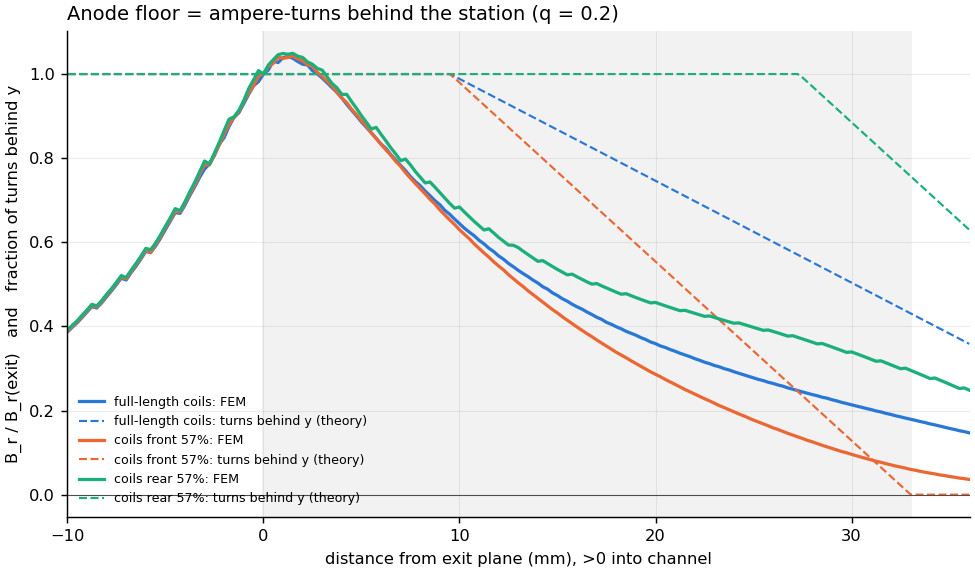

The direction holds: coils pushed forward drop the anode floor from 17 % to
about 5 %, coils pushed back raise it to 28 %. The magnitude is smaller than the
bare turn count because the channel sits 8-20 mm from the windings, and the
pole-gap fringe dominates the first ~10 mm. That fringe tail is why screens
outperform coil placement.

---

## 2. Studies

All cases use the 2026-10-15 pole tips (front plate tapered to 1.5 mm over
15 mm, r20 pole cap tapered to 1.5 mm over 6 mm) unless marked "flat". Each
is scored at its minimum-power ratio with the peak scaled to 300 G. Data:
`results/shaping/*.csv`.

### S1 Coil axial placement

Coils occupying the front fraction f of the core length, same turns (the
build grows as 1/f). The inner coil can shrink to f = 0.48 before it hits the
channel keep-out.

| case | anode B_r % | sigma mm | P W |
|---|---|---|---|
| full length (reference) | 17.2 | 13.9 | 1.9 |
| both coils front 70 % | 9.7 | 12.8 | 2.1 |
| both coils front 57 % (end at anode plane) | 5.7 | 12.1 | 2.2 |
| both coils front 48 % | 3.4 | 11.6 | 2.3 |
| inner only front 57 % | 7.5 | 12.3 | 2.1 |
| outer only front 57 % | 15.9 | 13.6 | 1.9 |
| both rear 57 % (theory check) | 28.2 | 16.8 | 2.2 |

**The inner coil's placement is what matters**; the outer coils are too far
from the channel. Effective and costs nothing in parts, but it reaches only
about 3 % and leaves sigma near 12 mm.

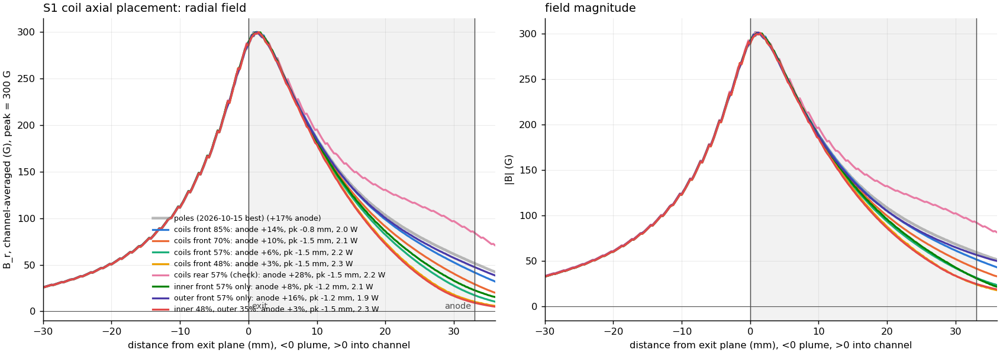
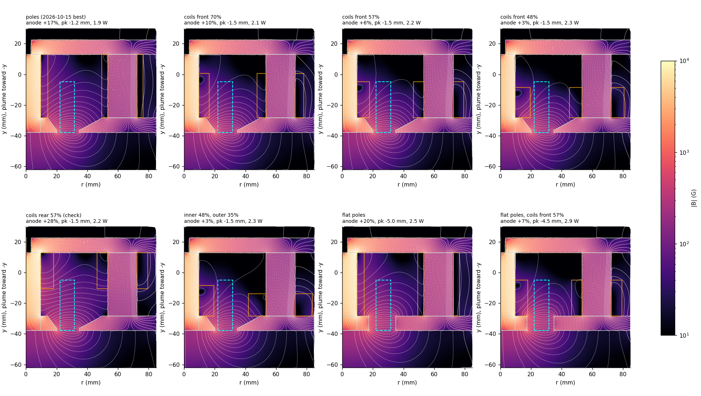

### S2 Rear air gaps and back-plate thickness

| case | anode B_r % | P W |
|---|---|---|
| inner core to back plate gap 0.25 / 0.5 / 1 / 2 mm | 12.8 / 9.6 / 5.0 / -1.1 | 2.8 / 3.6 / 4.9 / 7.1 |
| outer posts to back plate gap 0.5 / 1 / 2 mm | 16.9 / 16.7 / 16.3 | 2.0 / 2.0 / 2.1 |
| back plate 3.2 / 6.4 / 15.9 mm | 17.0 / 17.1 / 17.2 | 1.9 |

A core gap nulls the floor as predicted, but a 1 mm gap costs 2.6x the
power and 2 mm costs 3.7x. Post gaps and plate thickness do nothing to the shape. A
3.2 mm back plate raises its peak iron |B| to 0.78 T but stays unsaturated.

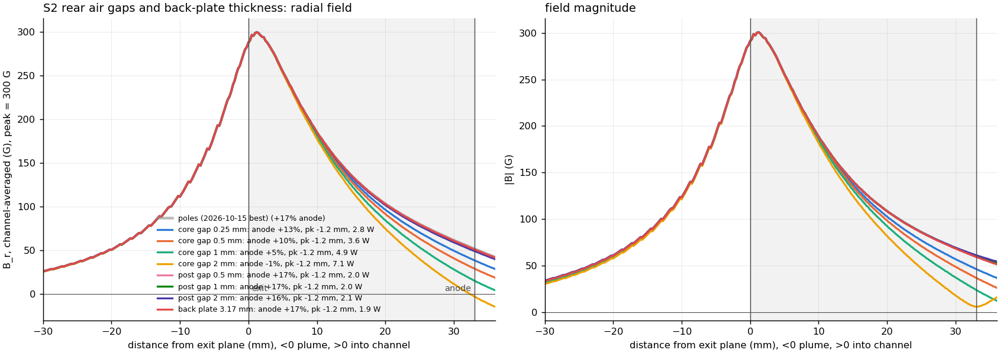

### S2b Front plate + pole cap thickness (flat poles)

| thickness mm | 3.2 | 4.8 | 6.4 | 9.5 (as built) | 12.7 |
|---|---|---|---|---|---|
| peak mm | -1.7 | -2.7 | -3.5 | -5.0 | -7.0 |
| anode B_r % | 19.7 | 19.3 | 19.4 | 20.3 | 22.1 |

Plate thickness moves the peak (it sits near the middle of the pole face) and
nothing else. The tapered tips already get this benefit without thinning the
whole plate.

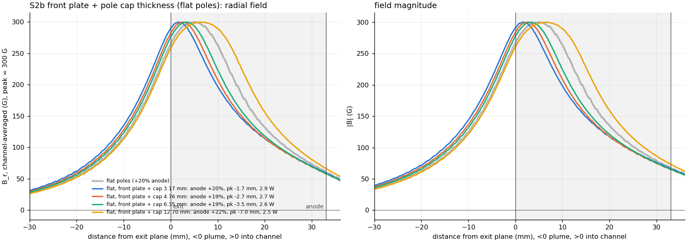

### S3 Magnetic screens

Iron tubes from the back plate forward to `gap` mm short of the pole-cap /
front-plate back faces. Inner screen r 14.7-16.2 (1.5 mm, outside the inner
coil); outer screen r 40-43.

| case | anode B_r % | sigma mm | misfit % | P W |
|---|---|---|---|---|
| both, gap 3 | 1.9 | 8.2 | 2.1 | 2.0 |
| both, gap 6 | 1.5 | 8.9 | 1.5 | 2.0 |
| both, gap 10 | 1.3 | 10.1 | 1.7 | 1.9 |
| both, gap 15 | 1.6 | 11.3 | 2.8 | 1.9 |
| inner only, gap 6 | 4.0 | 9.4 | 2.8 | 1.9 |
| outer only, gap 6 | 17.0 | 13.7 | 8.2 | 1.9 |
| both gap 6, outer at r35 / r45 | 2.1 / 1.2 | 9.1 / 9.0 | 1.9 / 1.5 | 2.0 |

The gap sets sigma (shorter gap, sharper peak). The outer screen's radius
barely matters.

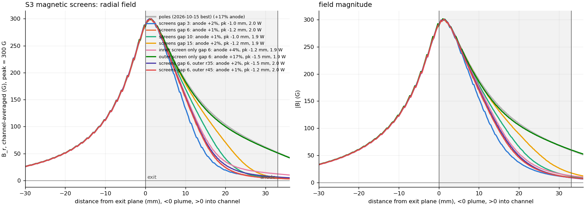
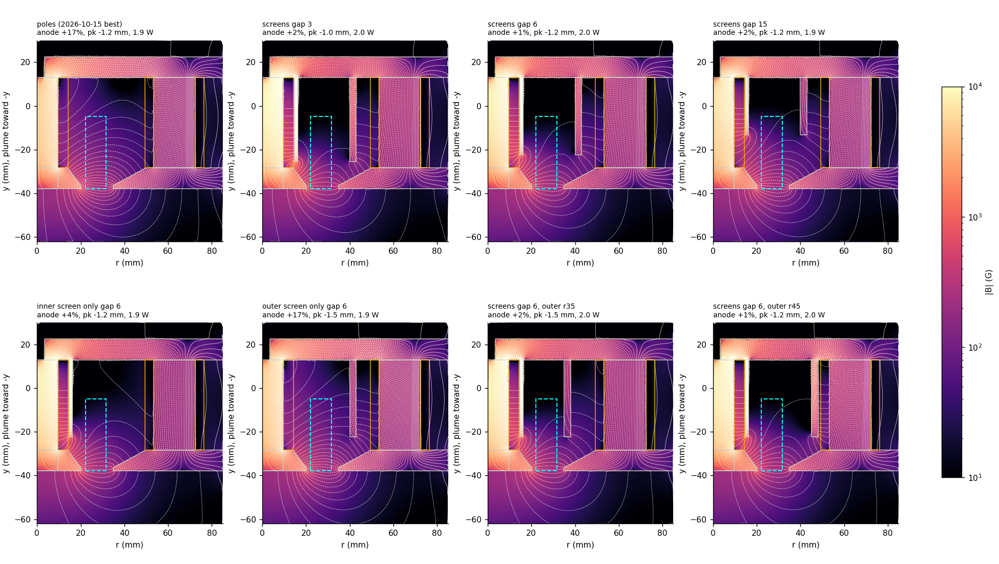

### S4 Combinations

| case | pk mm | anode B_r % | sigma mm | misfit % | P W |
|---|---|---|---|---|---|
| inner screen 3 mm, gap 6 | -1.0 | 3.6 | 9.0 | 2.7 | 1.9 |
| inner screen 3 mm, gap 3 | -1.0 | 4.1 | 8.1 | 3.6 | 2.0 |
| inner + outer screen, gap 6 | -1.0 | 0.6 | 8.5 | 1.7 | 2.0 |
| inner coil 57 % + inner screen | -1.5 | 4.9 | 8.9 | 3.4 | 2.1 |
| inner screen + 2 mm cap lip | -0.2 | 3.4 | 8.5 | 2.6 | 1.8 |
| **both screens + 2 mm cap lip** | **-0.2** | **0.6** | **8.1** | **1.1** | **1.8** |

Coil placement adds nothing once a screen is present: the screen already
hides the coil. The cap lip (rim extended 2 mm past the exit plane, into the
plume) is what lands the peak on the exit.

Inner-screen bulk flux density is 0.3-0.4 T (95th percentile 0.4-0.5 T), so
A36 is far from saturation. The ~1.0 T "peak iron" values in the summary are
corner singularities at the screen root and the core/back-plate joint.

The winner's shape holds over the outer/inner ratio: anode 0.6 / 0.9 / 1.0 %,
sigma 8.1-8.2 mm at q = 0.2 / 0.635 (spec) / 1.0. At the spec ratio it needs
263 / 167 A-turns (2.5 W) in this 2-D model.

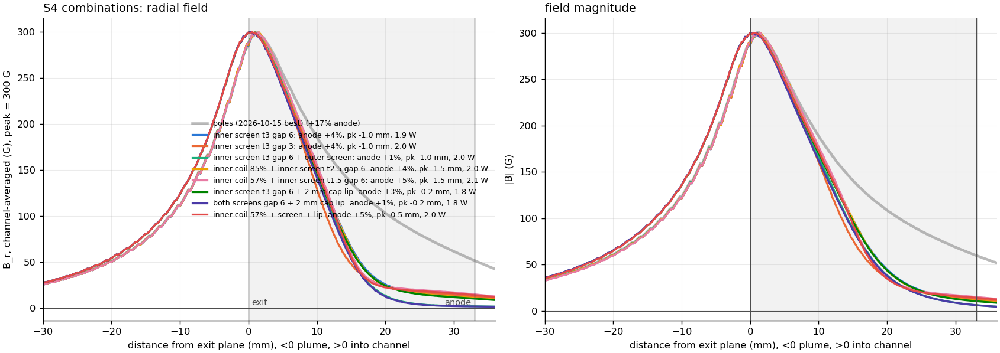
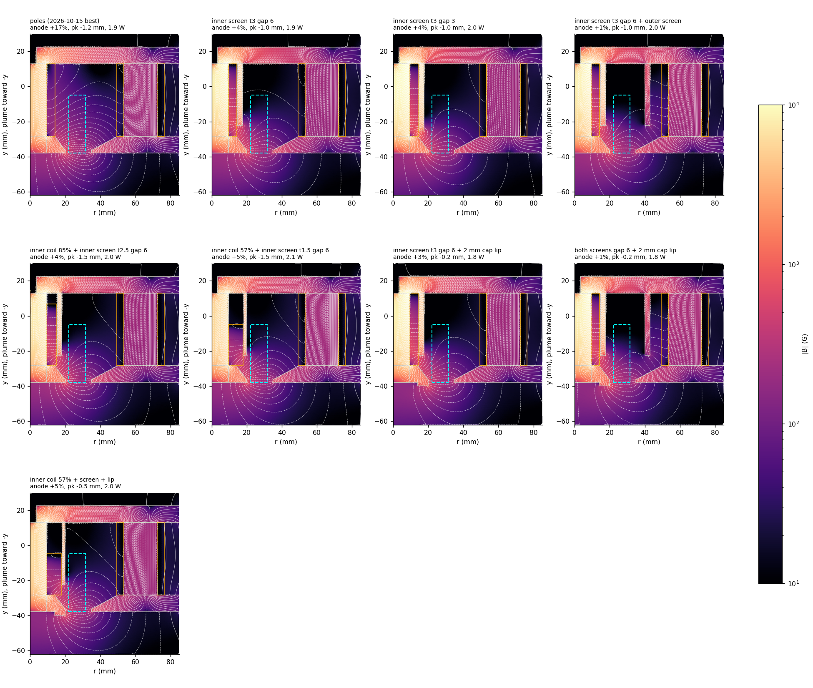

---

## 3. Summary of every case

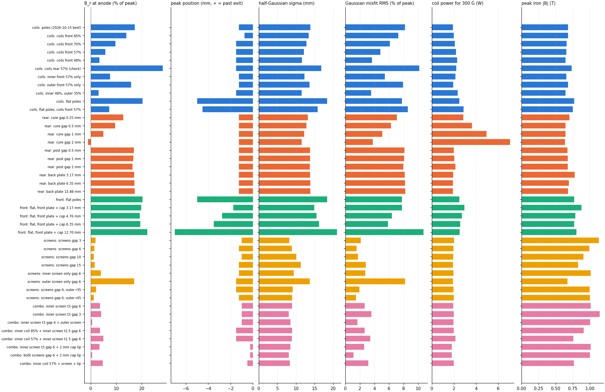
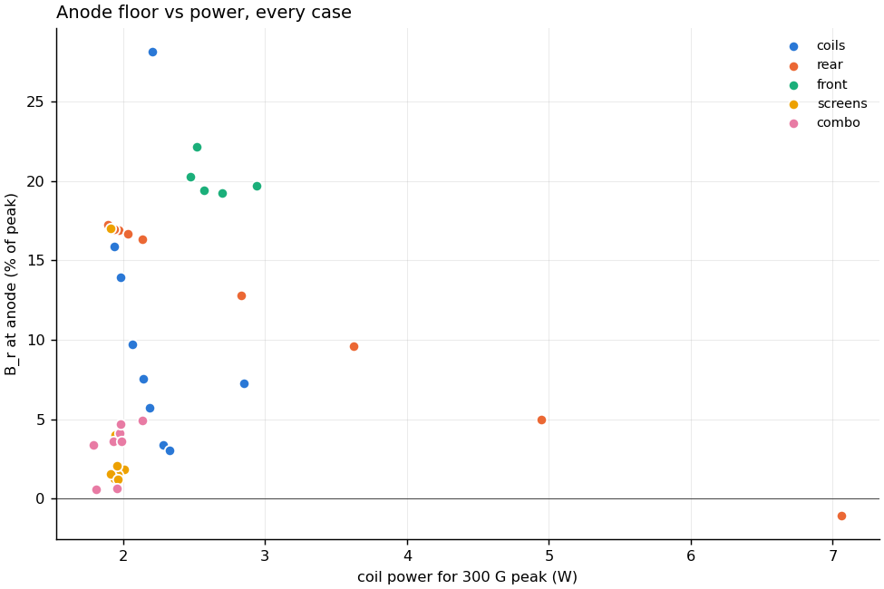

## 4. Ranking (simplest first)

1. **Inner screen** (one 3 mm A36 tube on the back plate, tip 6 mm behind the
   pole cap): anode 17 % to 3.6 %, sigma 14 to 9 mm, no power cost. Best value
   per part.
2. **+ outer screen** (A36 tube r 40-43): anode to 0.6 %, Gaussian misfit 1.7 %.
3. **+ 2 mm cap lip**: peak onto the exit plane (-0.2 mm).
4. Inner coil moved forward: works alone (to 3 %), redundant with screens.
5. Core gap: works, but costs 2.5-3.7x the power. Not recommended.
6. Back-plate thickness, post gaps, outer screen alone: no effect on the shape.

## 5. Caveats and next steps

- 2-D axisymmetric, linear iron (mu_r 1500). Calibrated against the 3-D
  solve: shape within 1 % RMS, amplitude 5-7 % high. The four outer posts are
  a smeared ring here. The screens are true tubes, so they are well
  represented, but the post/coil detail near the outer screen is not.
- **Fit not checked against CAD.** The inner screen (r 14.7-17.7) must fit
  between the inner coil OD (14.29) and the channel wall (keep-out 20.62).
  The outer screen (r 40-43) must fit between the channel and the outer
  coils, around the chamber, gas feed and anode wiring. The cap lip
  protrudes 2 mm into the plume and will see ion erosion.
- Recommended next step: confirm the winner in the 3-D pipeline (nonlinear
  A36), and check the screens against the Onshape assembly.

Reproduce: `python shaping.py theory coils rear front screens combo summary headline`
(about 15 s per new geometry; solves are cached in `runs/`).
