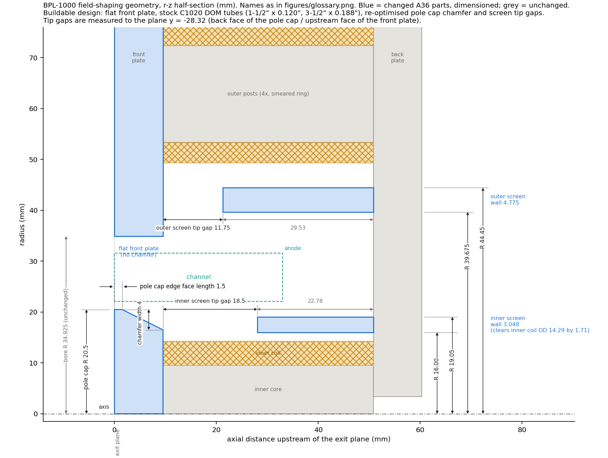
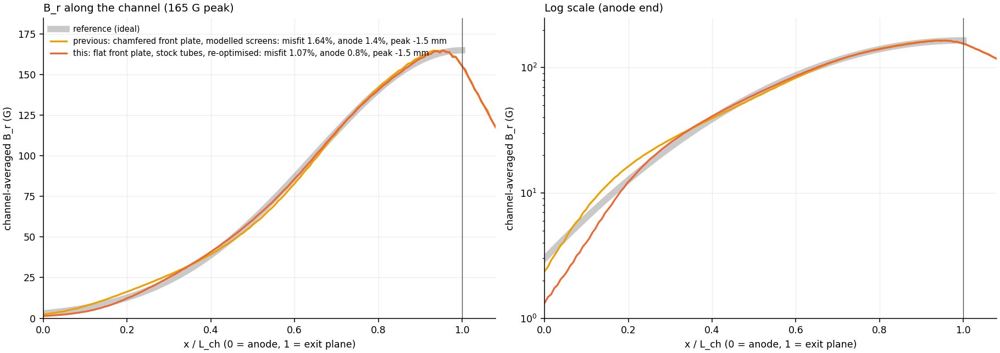
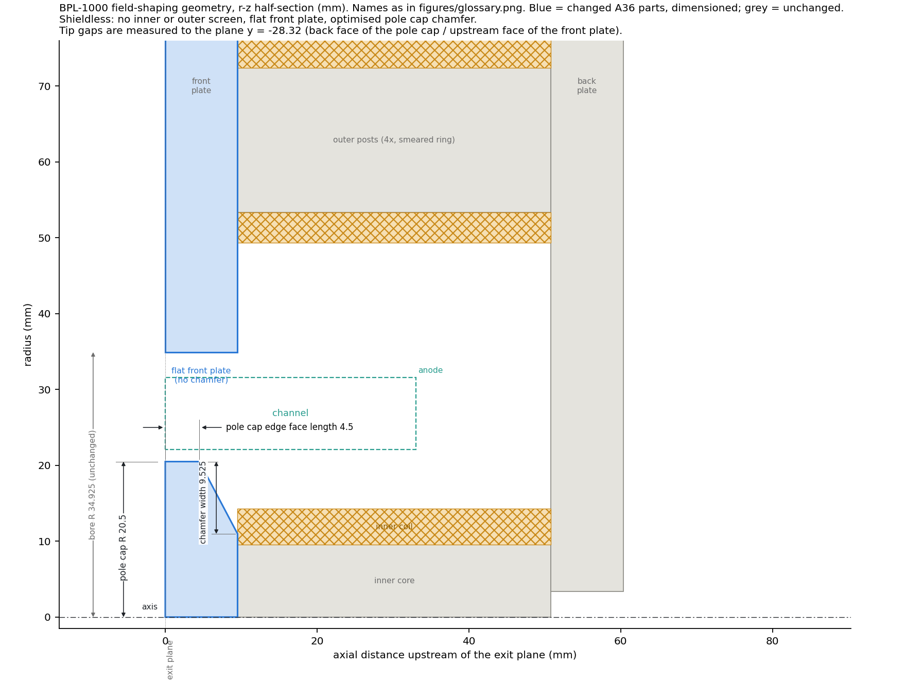
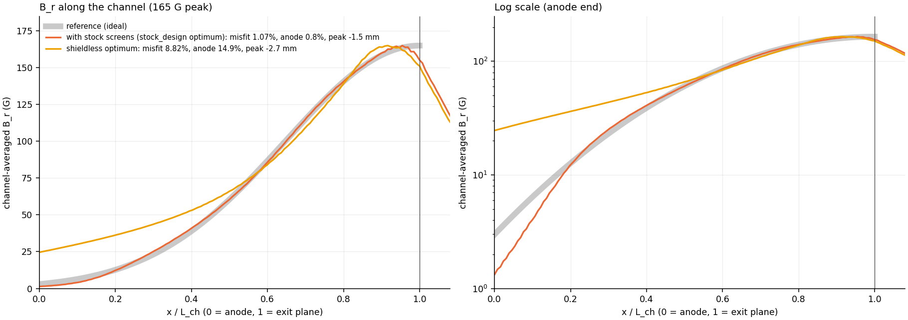
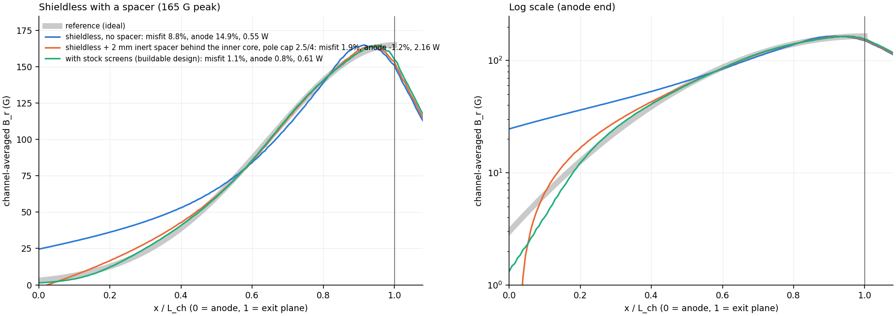

# Buildable design and the shieldless alternative (2-D axisymmetric, 2026-10-21)

Feature names follow `figures/glossary.png`. Every case is scored against
the reference profile: sigma 11.66 mm, 165 G, peak on the exit plane
(`TARGET_REPORT.md`). Rule: nothing past the exit plane.

## 1. Buildable design (`stock_design.py`)

**Fixed:**
- **Front plate:** flat, no chamfer.
- **Inner screen:** stock 1-1/2" OD x 0.120" wall C1020 DOM tube, r 16.00-19.05.
- **Outer screen:** stock 3-1/2" OD x 0.188" wall C1020 DOM tube, r 39.67-44.45.
- **Pole cap radius:** 20.5.
- **Iron permeability:** mu_r 1500.

**Free:**
- inner screen tip gap and outer screen tip gap (the two screen lengths);
- pole cap edge face length and pole cap chamfer width.

**Search:** 600-case grid, then a compass search down to 0.25 mm steps.

**Optimum:**

| feature | value (mm) |
|---|---|
| pole cap edge face length | 1.5 |
| pole cap chamfer width | 4.0 |
| inner screen tip gap | 18.5 (screen length 22.78) |
| outer screen tip gap | 11.75 (screen length 29.53) |

| | reference | **this design** | previous (chamfered front plate, modelled screens) |
|---|---|---|---|
| RMS misfit to reference | 0 | **1.07 %** | 1.64 % |
| max misfit | 0 | 6.0 % | 5.8 % |
| peak position | on exit plane | 1.5 mm inside | 1.5 mm inside |
| B_r at exit plane | 100 % | 94.0 % | 94.2 % |
| B_r at anode | 1.8 % | **0.8 %** | 1.4 % |
| sigma | 11.7 mm | 12.2 mm | 12.1 mm |
| power at 165 G | | 0.61 W | 0.62 W |
| worst saturation ratio at 165 G | | 0.22 | 0.23 |

The flat front plate costs nothing. The re-optimised screen lengths more than
make up for it: a shorter outer screen, and an inner screen 2.5 mm longer
than before.

**Robustness at the optimum** (`results/stock/check.csv`):

- **±0.5 mm on any free knob:** misfit 1.10-1.32 %; B_r at the anode
  0.76-0.85 %.
- **Screens at mu_r 500 / 200 / 100, rest at 5000:** misfit 1.09 / 1.48 /
  2.34 %; B_r at the anode 1.6 / 2.9 / 4.7 %.
- **All iron at mu_r 100:** misfit 1.49 %, B_r at the anode 2.2 %, power
  1.98 W.

## 2. Shieldless (`shieldless.py`)

**Setup:** no inner or outer screen, flat front plate, pole cap radius 20.5.
Free: pole cap edge face length and pole cap chamfer width (37-case grid,
then a search).

| case | misfit | B_r at anode | peak position | sigma | power at 165 G |
|---|---|---|---|---|---|
| **optimum: edge face length 4.5, chamfer width 9.525** | **8.8 %** | 14.9 % | 2.7 mm inside | 14.1 mm | 0.55 W |
| edge face length 1.5, chamfer width 6 | 9.6 % | 15.7 % | 1.7 mm inside | 14.0 mm | 0.61 W |
| flat pole cap | 12.2 % | 14.9 % | 4.8 mm inside | 15.8 mm | 0.53 W |

**Without screens the pole cap chamfer cannot get below about 9 % misfit.**
About 15 % of peak B_r stays at the anode with every chamfer. That is the
inner coil's drive leaking into the channel along its length, and only the
screens (or moving the coil, below) remove it. The chamfer only trades peak
position against width.

**Not tried:** moving the inner coil toward the exit plane. In the 10-18
study, winding it over only the front part of the inner core cut the anode
field from 17 % to about 3 % without screens.

Reproduce: `python stock_design.py all`, `python shieldless.py all`.

## 3. Shieldless with a spacer (`spacer.py`)

**Setup:** the back plate moves L upstream; the channel, anode, front plate
and pole cap stay put. Four ways to fill the extra length:

| variant | L | misfit | B_r at anode | power at 165 G |
|---|---|---|---|---|
| no spacer | 0 | 8.8 % | 14.9 % | 0.55 W |
| taller (cores, posts and coils all longer by L) | 5-60 mm | 9.8-14.0 % | 17-26 % | 0.50-0.26 W |
| iron spacer (cores and posts longer, coils unchanged) | 5-60 mm | 8.9-8.5 % | 15.1-14.2 % | 0.56-0.61 W |
| inert spacer behind cores **and** posts | 1.5 mm | 3.0 % | −0.2 % | 2.0 W |
| inert spacer behind cores and posts | 5-60 mm | 7-16 % | −14 to −33 % (reversed) | 3.9-7.4 W |
| **inert spacer behind the inner core only** | 2 mm | 3.0 % | −1.2 % | 2.1 W |

- **Taller makes it worse.** More of the coils' ampere-turns end up behind
  the anode plane, even though power drops.
- **An iron spacer is neutral.**
- **An inert spacer works, but only thin.** It is the core-gap mechanism from
  the 10-18 study. The non-magnetic gap drops part of the inner coil's drive
  across itself, so less of it reaches the channel near the anode. The anode
  field crosses zero near 1.5-2 mm. Thicker spacers reverse it and cost
  7-13x the power. The gap behind the inner core does most of the work.
  Adding one behind the outer posts only shifts the zero crossing to a
  slightly thinner spacer, so a single spacer behind the inner core is
  enough.

**Pole cap chamfer re-swept with the spacer:** best is edge face length 2.5,
chamfer width 4 (36-case grid).

| inert spacer behind the inner core, pole cap 2.5/4 | misfit | B_r at anode | power at 165 G | inner / outer current at 165 G |
|---|---|---|---|---|
| 1.5 mm | 2.67 % | +1.2 % | 1.87 W | 1.00 / 0.79 A |
| **1.75 mm** | **2.23 %** | **−0.1 %** | **2.02 W** | 1.04 / 0.82 A |
| 2.0 mm | 1.94 % | −1.2 % | 2.16 W | 1.07 / 0.85 A |
| 2.25 mm | 1.81 % | −2.3 % | 2.29 W | 1.10 / 0.87 A |
| 2.5 mm | 1.84 % | −3.3 % | 2.42 W | 1.13 / 0.90 A |

- **Which thickness:** RMS misfit keeps improving to 2.25 mm, but past about
  1.75 mm B_r reverses near the anode (it crosses zero at x/L about 0.04 at
  2 mm). **1.75-2 mm** is the useful range.
- **Sensitivity:** about 5 % of peak at the anode per mm of spacer, so it
  needs ±0.1 mm control. It also makes a good tuning knob: swap shims on the
  stand.
- **Insensitive to permeability:** all iron at mu_r 200-5000 changes the
  anode field by only −1.2 to −1.5 %, because the gap, not the iron, sets the
  balance. Power rises from 2.1 to 3.0 W at mu_r 200.
- **Peak and width** are unchanged by the spacer: 1.7 mm inside the channel,
  sigma 12.4 mm.

**Against the buildable design with screens:** misfit 1.9-2.2 % vs 1.07 %,
and power 2.0-2.2 W vs 0.61 W (3.3-3.6x) at 165 G. It does remove both
screens and the dependence on screen permeability.

Reproduce: `python spacer.py sweep`, `small`, `chamfer 4 2.0`, `best`, `mu`.
