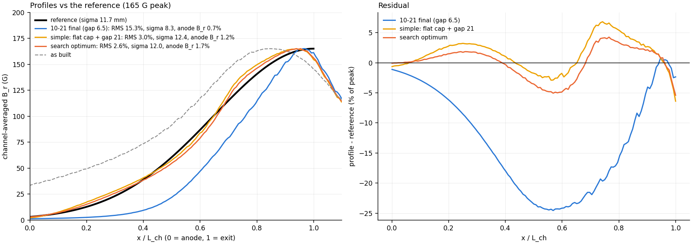
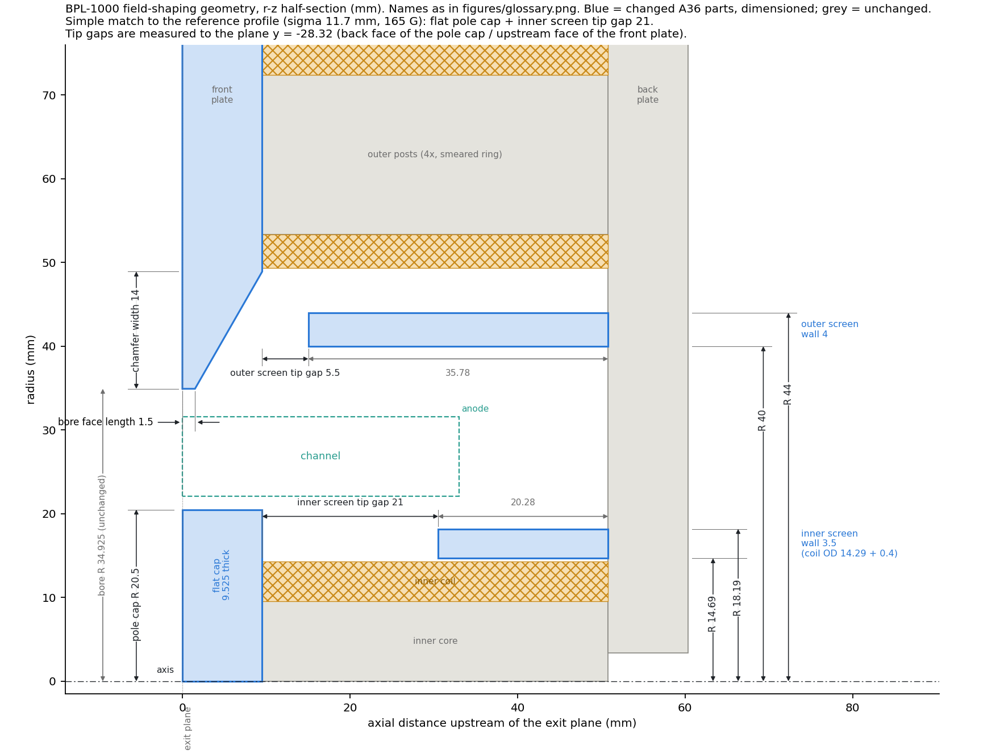
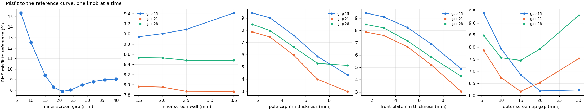

# Matching the reference B_r profile, BPL-1000 (2-D axisymmetric, 2026-10-21)

## The reference

The supplied reference is a plot of B vs x/L_ch. I digitised it from its
pixels and fitted it. It is a pure half-Gaussian peaked at the exit plane:

**sigma = 0.353 L_ch, B_max = 165 G.**

The fit is very tight: the pinned-amplitude residual is 0.19 % of peak, and
a free fit with an offset returns sigma 0.353 and offset ≈ 0. With
L_ch = anode-to-exit = 33.02 mm (confirmed by the user), that gives:

- **sigma = 11.66 mm**
- half-depth 13.7 mm
- B_r at the anode 1.8 % of peak (3.6 G)

This is wider than anything in the 10-21 sigma family (7.2-9.9 mm).

## Result

The simplest match changes **two things** on the 10-21 final geometry:

1. **Flat pole cap.** Drop the cap taper. The cap stays at r 20.5 but goes
   back to the full 9.525 mm thickness.
2. **Inner-screen tip gap of 21 mm** instead of 6.5 mm, which makes the
   screen 14.6 mm shorter.

The front-plate taper and the outer screen are unchanged.

| | reference | 10-21 final (gap 6.5) | **simple: flat cap + gap 21** | search optimum |
|---|---|---|---|---|
| RMS misfit to reference (% of peak) | 0 | 15.3 | **3.0** | 2.6 |
| max misfit (% of peak) | 0 | 24.6 | 6.8 | 5.4 |
| sigma (mm) | 11.7 | 8.3 | **12.4** | 12.0 |
| half-depth (mm) | 13.7 | 9.7 | **14.0** | 13.5 |
| B_r at anode (% of peak) | 1.8 | 0.7 | **1.2** | 1.7 |
| \|B\| at anode (% of peak) | – | 0.7 | 6.7 | 6.6 |
| peak position (mm, - = inside channel) | 0 | -1.0 | -2.0 | -1.5 |
| B_r at exit (% of peak) | 100 | 97.7 | 93.6 | 94.6 |
| coil power at 165 G (W) | – | 0.71 | **0.66** | 0.68 |
| worst saturation ratio at 165 G | – | 0.28 | 0.24 | 0.24 |

Notes on the table:
- **Search optimum geometry:** flat cap, inner screen gap 19 mm with a 2 mm
  wall, front-plate taper 17 mm, outer-screen gap 1.5 mm. These four changes
  beyond the simple variant buy 0.4 points of RMS misfit. The 1.5 mm
  outer-screen gap almost closes the screen onto the front plate. That is not
  worth the extra changes, so the drawing shows the simple variant.
- **Power and saturation** are 2-D values. The 2-D currents are not the 3-D
  spec values (see `OPTIMISE_REPORT.md`, caveats), but every option needs
  about 0.3 x the power of the 300 G design point.

## What each knob does

`results/target/sweeps.csv` holds 67 runs, swept one knob at a time
(the last four knobs at inner-screen gaps of 15, 21 and 28 mm).

- **Inner-screen gap alone stalls at 7.9 % RMS misfit,** at a gap of about
  21 mm. Past that the inner wall is no longer screened, and the anode tail
  grows faster than the profile widens. The fit gets worse again, toward the
  9 % of the no-inner-screen case.
- **Rim thickness is the widening lever.**
  - The thin 1.5 mm rims sharpen the pole gap; that was how they pulled the
    peak forward. The reference needs a broader peak, so thick rims win.
  - A full 9.525 mm cap, or a full 9.525 mm front plate, each bring the
    misfit to about 3 %.
  - The search kept the thin front-plate rim plus the flat cap. Thickening
    both is not better.
  - The cost is the peak moving 1 mm further inside (-2.0 mm), with the exit
    at 94 % of peak. The reference peaks exactly at the exit.
- **Inner-screen wall:** almost no effect (0.1 points).
- **Outer-screen gap:** helps by 1-2 points up to a gap of about 15 mm at an
  inner gap of 21. In combination with the flat cap, the search preferred
  closing it to 1.5 mm instead (0.25 points).

## Where the remaining misfit sits

The residual (right-hand panel of the profile figure) has three parts:

- **x/L_ch 0.7-0.85:** the profile runs up to 6.8 % above the reference.
- **x/L_ch 0.95-1.0:** it falls about 6 % below, because the peak is 2 mm
  inside and the field has started to drop by the exit plane.
- **x/L_ch < 0.4:** within 3 % of the reference.

So our top is flatter and sits slightly upstream, and the reference's
steeper rise right at the exit isn't reachable without moving the peak onto
the exit plane. The only lever found for that is the cap lip, which was
declined on 10-18. The anode B_r matches (1.2 vs 1.8 %).

**The anode |B| is 6.7 %, mostly axial field.** It comes from the shortened
inner screen's tip, and it is larger than the anode B_r. The reference
specifies B_r only, so this isn't scored, but it is new: the 10-21 design had
0.7 % in both. Whether axial field at the anode matters is a plasma question.

## Caveats

- 2-D axisymmetric, linear iron (see `OPTIMISE_REPORT.md`).
- The front-plate taper is now limited so it stops 1 mm short of the outer
  posts (width ≤ 17.4 mm). The first search ran without this limit and found
  a 28.5 mm taper, which would leave an air gap at the post seat.
- The 3-D nonlinear confirmation and the CAD fit check are still open. The
  flat r 20.5 cap needs the same keep-out check as before.

Reproduce: `python target_sigma.py sweeps search figures`. Solves are cached
in `runs/opt/`.
