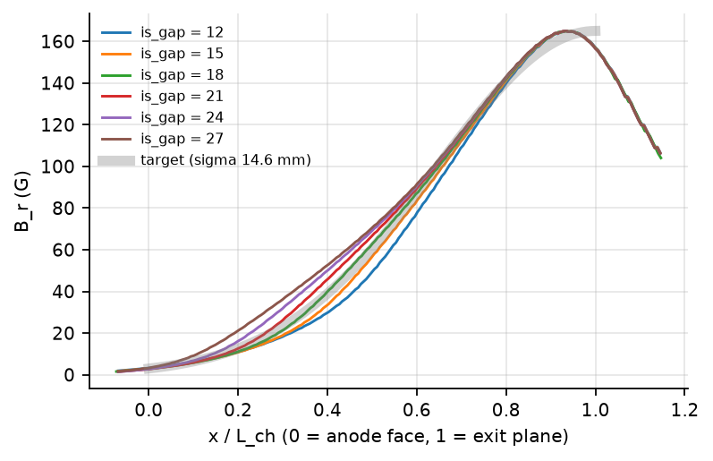
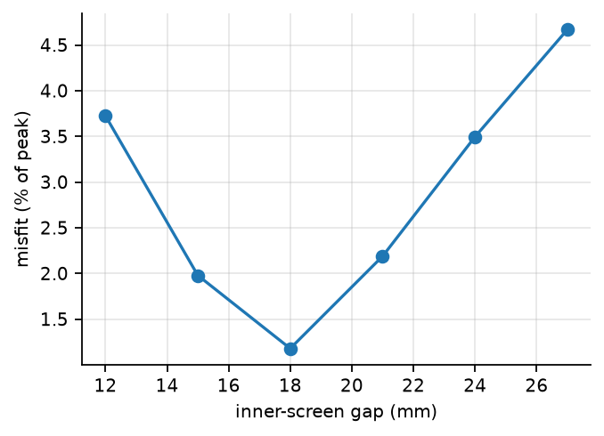

# Design A: inner-screen gap sweep

Generated by `bplsim report build` from study `2026-10-29_design_a_gap_sweep`; every number and figure
below comes from the trade database, so re-running the build after new results updates the report.

The best fit is at an inner-screen gap of 18 mm:
misfit 1.178 % of peak,
sigma 15.2 mm,
coil power 1.58 W at 165 G.

| is_gap | misfit.rms_pct | shape.sigma | shape.anode_Br_pct | power.total | sat.worst |
|---|---|---|---|---|---|
| 12 | 3.725 | 0.0141 | 1.952 | 1.596 | 0.3289 |
| 15 | 1.978 | 0.0146 | 1.822 | 1.584 | 0.3154 |
| 18 | 1.178 | 0.0152 | 1.705 | 1.576 | 0.293 |
| 21 | 2.188 | 0.0157 | 1.63 | 1.57 | 0.2937 |
| 24 | 3.495 | 0.0161 | 1.666 | 1.566 | 0.2847 |
| 27 | 4.668 | 0.0165 | 1.968 | 1.564 | 0.2768 |

